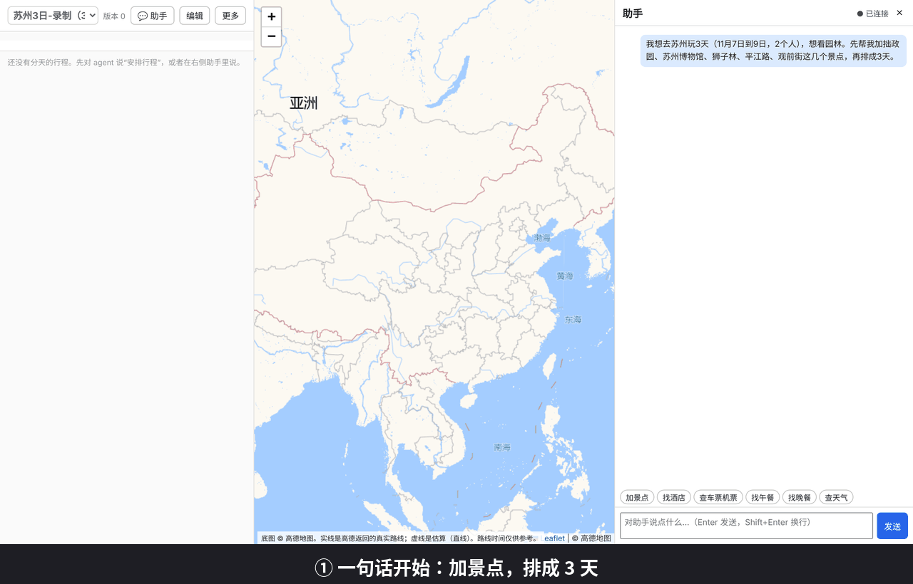
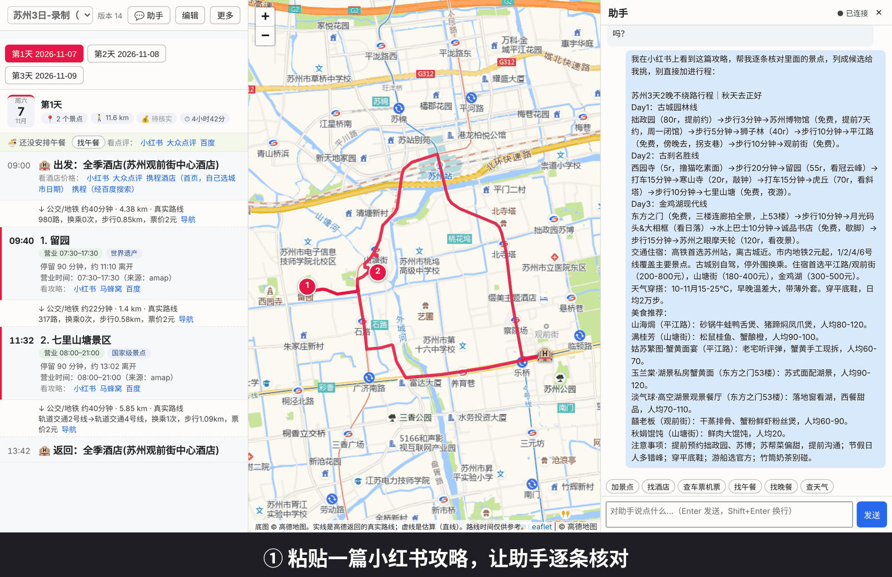
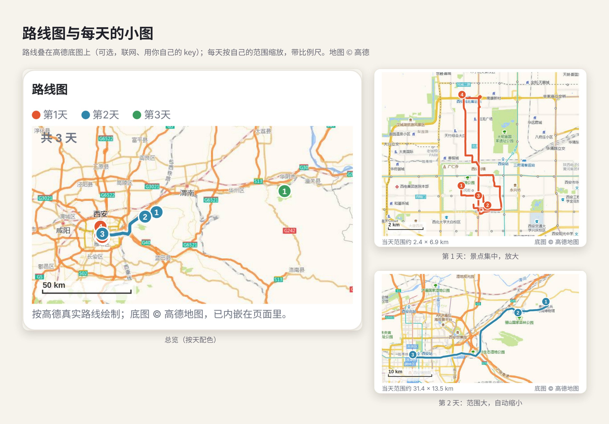

<div align="center">

# 🧭 TripSight

**Turn other people's guides into a trip that is yours — and checkable at every step.**

Real Amap routes, one click to research on Xiaohongshu / Dianping, paste any guide and edit it stop by stop, and chain every route of the whole journey in one go so you never look up directions again on the road.
The LLM only understands you and proposes changes; scheduling, opening hours, routes, versioning and undo are deterministic code.

[中文](README.md) · [Setup](docs/SETUP.md) (Chinese) · [Design notes](DESIGN.md) (Chinese)


<a href="docs/images/poster.png"></a>

> **The LLM only proposes; scheduling, checking and undo are done by code.** In the demo below, dragging the Palace Museum onto a Monday is flagged at once ("closed", "over the pace limit"), and nothing changes until you confirm.

<table>
<tr>
<td rowspan="2" align="center" valign="top" width="200"><br><sub>Web workbench: drag to edit, instant checks</sub></td>
<td align="center" valign="top"><br><sub>Plan by chatting: add stops, schedule, confirm proposals, pick food and lodging, real routes (<a href="docs/videos/chat-plan.mp4">HD video</a>)</sub></td>
</tr>
<tr>
<td align="center" valign="top"><br><sub>Paste a guide: check each item, list candidates, pick and add (<a href="docs/videos/chat-paste.mp4">HD video</a>)</sub></td>
</tr>
</table>

<sub>The demo uses the bundled Beijing sample data; opening hours are sample values for illustration. The real workbench has three panes: itinerary (left), Amap map (middle), chat assistant (right).</sub>

</div>

---

## 😩 Pain points of guides and existing tools

Following someone else's guide usually breaks down on a few things:

1. **Other people's guides are incomplete.** A guide tells you *what to see*, not your whole trip: **where you sleep, when you arrive and leave**, and **which season** you travel in. Those are exactly what decide how much time the first day has, what fits on the last day, whether a place is open and whether the weather suits it. Copying a guide verbatim often means finding out on site that you are too late, it is closed, or the hotel is too far.
2. **Personal touches are hard to merge.** The small shop you want to visit, a friend's tip, the pace your family needs, your dislike of walking — none of it is in the guide, and squeezing it in by hand means re-ordering everything and re-calculating every leg.
3. **Looking up how to get between sights is repetitive.** Walk, transit or taxi for every pair of stops, one by one in a map app, again after every change.
4. **Itineraries generated directly by an LLM are unreliable.** It confidently makes things up — a sight that is long closed, two places two hours apart called "nearby" — and fixing one thing can break the rest.

## ✨ What is TripSight

TripSight attacks these one by one:

- **Places can come from anywhere:** an **LLM recommendation**, **someone else's guide** (paste the text, every item verified, you pick), or **somewhere you want to go yourself** — all three are scheduled together in one trip.
- **It fills in what guides leave out:** hotel, arrival/departure transport, dates and season are part of the trip and feed into day assignment, opening-hours checks and first/last-day playable time.
- **Personal touches merge in place:** your preferences are remembered, and any single stop can be moved to another day, removed, locked or re-timed, with automatic re-checking — no starting over.
- **No more repeated route look-ups:** with Amap configured, real routes for every leg are filled in at once, and one click generates a chained personal map for each day.
- **Facts come from code and tools, never from the model's imagination:** the **LLM** (via chat) only understands intent and proposes changes; **tripcore** (deterministic code, 60 MCP tools) schedules, checks, fetches routes, versions and undoes; **you** confirm every change.

It is not another "one-click guide generator" but a workbench where the plan can be adjusted again and again and checked at every step.

> ✅ Amap routes, opening hours and coordinate verification have been tested by the author with a real Amap key and work. Other integrations (Google Maps, the WeChat channel, …) are mainly tested against fake services (automated tests); real-environment verification is limited. Prices, hours and weather are reference values — verify with official sources before you travel. The assistant never books or pays.

## 💡 Why TripSight

- **Facts are never invented.** Coordinates, hours, routes and weather come only from map services and tools; when something cannot be determined the tool says "unverified" instead of guessing.
- **Opening hours take part in scheduling**, not just in after-the-fact warnings: closed days and impossible time slots are avoided, and places that cannot fit are listed with the reason.
- **Every step is confirmable and undoable.** Changes are proposals applied only after you reply with a confirmation code; confirmed items are locked so re-planning never shuffles them; `undo` works repeatedly.
- **Not tied to one model or platform.** It is an MCP server, so any MCP-capable chat agent can use it; the repo ships setup for [nanobot](https://github.com/HKUDS/nanobot).
- **Your data stays on your machine.** Trips are local JSON files, the workbench listens on `127.0.0.1` only, keys live in your own config, and `tripcore doctor` only prints "configured / not configured".

## 🖼️ At a glance

**Plan by chatting.** Ask the assistant to add stops and schedule 3 days; changes are proposed first and applied only after you confirm; hotels are recorded, never booked; one sentence turns every leg into a real Amap route. The itinerary panel, map and chat update together. ([HD video](docs/videos/chat-plan.mp4), 2560 wide)

**Paste someone else's guide.** Paste a Xiaohongshu guide: places already in the trip are skipped, new ones are checked one by one and listed as candidates (nothing is added yet); after you pick, the assistant verifies real names and opening hours on Amap, and adds them only after you confirm, saying plainly what does not fit. ([HD video](docs/videos/chat-paste.mp4), 2560 wide)

<sub>The conversations and itineraries are real recordings (the assistant's replies are not edited); basemap © Amap; the guide text was pasted by the author from a Xiaohongshu post.</sub>

**8 share themes, one click.** The same itinerary in a different look to send to friends; all light backgrounds, hotels and costs are hidden by default.

<a href="docs/images/showcase-themes.jpg"></a>

**Route map over the Amap basemap.** The share page includes an inline SVG route map and can export a route-animation GIF. You can optionally overlay the Amap basemap (needs your own `AMAP_KEY`; the page stays a single file). Each day zooms to its own extent with a scale bar.

<a href="docs/images/showcase-routes.jpg"></a>

<sub>The trips shown are the author's own test trips; opening hours come from Amap; basemap © Amap.</sub>

## 🌟 Full-configuration experience

Connect an Amap key, the nanobot chat agent and the read-only price skills (`python -m tripcore doctor` tells you what is missing) and you get this way of working:

- **Real routes, not simulations.** With Amap configured, `refine_routes` replaces every estimate with the route Amap returns — walk/transit/drive time, transfers, walking distance, fares, and the real route shape on the map. Without a key it falls back to straight-line estimates and labels them "estimated".
- **Every stop corresponds to a real place.** Coordinates come from map search results (the workbench never accepts typed coordinates); a place is added only if the name matches and is unambiguous; opening hours are verified through `fill_hours`; every stop's arrival is checked against them. Unknown means "unverified", never an invented number.
- **Research any time.** One sentence gives you search links on Xiaohongshu, Dianping and Mafengwo, opened in your own browser with your own account; flight/train/hotel reference prices come from read-only skills that never book or pay.
- **Turn others' guides into your trip.** Paste any guide: code verifies each item against the source and you pick what to add. Afterwards every stop can be **edited individually** — move to another day, remove, lock, change the stay time or order — without starting over, and the plan is re-checked after each change.
- **As rigorous as possible.** Closed days, arriving after closing, past last entry, overloaded days, long legs, missing reservations, lodging too far, weather vs outdoor sights, transport connections — all checked by code and shown under the stop. Every change is a proposal you confirm, and it can be undone.
- **Unique and workable.** Your pace, walking limit, subway preference, lodging budget and food preferences are remembered and applied; lodging is suggested per night and meals are placed nearby — the result is tailored to you and actually feasible, not a generic template.
- **Add a place or change the hotel, then re-plan any time.** The plan is not generated once and frozen:
  - After you add **somewhere you personally want to go** (or places from another guide), **add or change lodging**, change lodging segments, dates, pace or walking preferences, tell the assistant to "re-plan" and it re-arranges every day with the latest places and lodging. With a single hotel, day grouping is built around it; with several hotels (segmented stays), each day's start and return use that night's hotel.
  - Arrangements you confirmed and locked stay put by default and only the rest is rearranged; to start over completely, say "re-plan including locked ones".
  - After re-planning, the "Update routes" button in the workbench (or `refine_routes`) fills the new legs with real Amap routes.
  - It never re-plans on its own: you ask for it, so you can compare before and after, and every re-plan is one version you can undo.
  - Places that do not fit in a day are listed under "unscheduled" with the reason (over daily capacity, etc.); add days, raise the pace, or swap something out.
  - A day fits when visit time plus that day's actual travel time stays within the pace limit. If neither you nor a guide gives a visit duration, the assistant estimates one from common sense and tells you it is an estimate; edit it any time.
  - After scheduling, if places were dropped or a day is packed, the assistant can dry-run a **relaxed version** (each day uses only 80% of the limit), compare it with the current plan, and apply it only if you agree (undoable).
- **Know what it will cost.** Tickets, your chosen restaurants and lodging are estimated per person count and shown **per day**; flight, train and hotel reference prices are read-only lookups with source and date. When nothing is found it says "to be verified" instead of inventing a number, and it warns when you exceed your budget or lodging cap.
- **Check the weather before you go.** Once dates are set, `get_weather` fetches each day (Amap in China; Open-Meteo, free and keyless, for dates Amap lacks or abroad). Outdoor stops are flagged on bad-weather days so you can decide whether to swap days.
- **Review it when you are back.** Record what each stop was really like and what you actually spent; `show_review` puts **plan next to actual** and suggests preferences worth keeping (for example: many skipped stops suggest a more relaxed pace next time; notes saying "too tiring" suggest a lower walking limit). You decide what to remember, and the next trip applies it automatically.
  - After the review you can **draft a travelogue**: `draft_travelogue` collects only facts you recorded (visited / skipped, ratings, notes), hotel and costs hidden by default; `check_travelogue` flags places you skipped or never recorded, amounts and times that do not match your records, and hotel names. Feelings and descriptions cannot be verified, so you read and edit them yourself.
  - Writing templates: `style` can be **Xiaohongshu / Moments / general**, returning a section structure, tone and length hints; Xiaohongshu hashtags come only from facts (destination city + places you visited, at most 5) — no trending-tag padding.
  - **Trip photos**: `add_photo` attaches your own photos to a stop or a day. They are re-encoded with Pillow, **EXIF location removed** and downsized (without Pillow it refuses to save rather than copy a geotagged file); it never fetches images from the web. The share image/page shows photos under their stops only with `show_photos`, off by default.
- **One click to chain every route of the journey.** Once the plan is settled:
  - `refine_routes` (the "update routes" button in the workbench) fills in real routes for every leg of every day;
  - `create_amap_map` turns each day's loop (hotel → sights → meals → hotel) into an Amap app personal-map link (or one merged map);
  - `export_map` / `export_gpx` / `export_text` produce a mobile map page, track files and WeChat-ready text.
  - `export_share` makes a **shareable long image (PNG) and a single-file web page**: one card per day (date block, stop count / distance / time, each stop's hours, transport, weather, map links). **Hotel and costs are hidden by default**; opt in to show them. No flight/train numbers, no keys, no embedded map. The PNG needs optional Playwright; without it you still get the page.

  On the road you just open the link and follow it — no more looking up each leg again.

> "Full configuration" means all keys and read-only skills are set up. The Amap part has been tested by the author with a real key; real-service testing of Google Maps, the WeChat channel and others is still limited. Verify key details yourself before you go.

## 🧩 Capabilities

| Area | What it does |
|---|---|
| **Planning** | Automatic day assignment and in-day ordering (geography + capacity + opening hours), pace levels, locking confirmed items, day-trip detection |
| **Checks** | Closed days, arriving after closing, past last entry, stay running past closing, overloaded days, long legs, missing reservations, budget, lodging too far, weather vs outdoor sights |
| **Maps & routes** | Amap / Google Maps / OpenStreetMap; real transit/walk/drive times, transfers, intercity-leg hints, airport/station transfers (late-night legs switch to taxi) |
| **Lodging & food** | Per-night / per-segment stay-area suggestions (multi-city aware), hotel candidates ranked by commute, restaurants near a stop, a named restaurant placed on the nearest day, "no lunch planned" reminders |
| **Guides → trip** | Paste a travel note or guide → every quote verified against the original text → coordinates verified on the map → you pick → added; walking routes (e.g. a city walk) can be one item |
| **Transport & weather** | Record arrival/departure flights or trains and derive first/last-day playable time; read-only flight/train/hotel reference prices; Open-Meteo and Amap weather |
| **Take it with you** | WeChat-friendly text, mobile HTML map, Amap app personal map, GPX, local web workbench |
| **Memory** | Remembers preferences you state explicitly (dislikes walking, budget cap, food) and applies them to new trips; post-trip review of actual costs and notes |
| **Engineering** | Multiple trips, version history and undo, `tripcore doctor`, Apache-2.0, 444 automated tests |

## 🔍 Feature details

1. **Scheduling.** `schedule_days` clusters places by geography, improves the assignment with cross-day moves and swaps, and orders each day (exact search up to 7 stops, nearest-neighbour + 2-opt beyond). With known dates, opening hours are part of the cost: closed days are skipped, orders that miss closing time are penalised, and places that can never fit are reported with a reason. Locked items never move; the same input always gives the same result.
2. **Opening-hours checks.** One timeline computes the expected arrival and departure of every stop and compares it with opening hours (closed, arrives after closing, past last entry, stay beyond closing, too early, day running late). The parser is conservative: it understands forms like "Tue–Sun 09:00-17:00", "Mar–Oct" or "closed Mondays from Nov 15", and says "cannot be determined" instead of guessing.
3. **Proposals, confirmation, undo.** The assistant cannot edit the trip directly. It creates a proposal (move, remove, set status, lock, set duration) and you see "before → after" plus a 4-digit code to confirm. Every change goes into version history; applying checks the revision so nothing is overwritten.
4. **Real routes and preferences.** With an Amap key, `refine_routes` upgrades estimates to real routes (time, transfers, walking distance, fares). Preferences (max transfers, prefer subway, max walking, taxi OK) change which option is chosen; `compare_transport` compares modes and `set_leg_mode` pins one leg. Legs over ~80 km are flagged as intercity. Overseas trips can use Google Maps; without keys OpenStreetMap is the fallback.
5. **Stay areas.** `suggest_lodging` works per night: it uses the last stop of one day and the first stop of the next, merges neighbouring nights into one stay, and splits into several stays when places lie in different cities. One-day excursions (e.g. a mountain 100 km away) are detected so the hotel stays in the main area. Each segment gives a centre, radius and a "search near X" hint for the assistant.
6. **Food.** `suggest_food` searches restaurants near a stop (rating, per-person price, hours, distance); nothing is added until you choose. `find_food` places a restaurant you name on the nearest day. The workbench shows "lunch not planned" per day with a one-click "find lunch" button.
7. **Guides → candidates.** The model reads and lists; code verifies. Each candidate's quote must appear verbatim in the pasted text and contain the place name, otherwise it is rejected. Only after you pick are coordinates looked up, and only unambiguous, non-duplicate matches are added. Prices and hours in a guide are treated as unverified hints. On submit, code looks every place up on the map (when an Amap/Google key is set) and labels it matched (with address and map link) / ambiguous / not found, plus jump links to Xiaohongshu, Dianping and Mafengwo. Day markers ("Day 2", "第二天") are detected by code, so you can compare a guide's day-by-day plan with yours (`compare_with_source`, read-only) or, only when you say so, lay it out as written (`follow_source_days`: places guide day N on your day N, locks them, lists what cannot work such as closed days, one undoable version). Every place also gets an expandable "what the guide says" box holding a verbatim excerpt (max 300 characters, verified against the pasted text, marked as someone else's claim) — the model never writes it. *Input today is pasted text; there is no Xiaohongshu scraper in this repo.* Want to browse other people's guides first? `search_links` (and the "look up guides" links under every stop in the workbench; hotel rows have "check hotel prices" links to Ctrip, Dianping and Xiaohongshu — hotel prices depend on dates and room type, so pick your dates after opening; tell the assistant the price you see and it records it as user-provided) opens search pages on Xiaohongshu, Dianping, Mafengwo and others — you click and log in with your own account; TripSight never scrapes or touches your accounts. Copy a guide's text back to continue. URL formats are not verified against real accounts.
8. **Transport, weather, prices.** `set_connection` derives when the first day can start and when the last day must leave. `get_weather` covers days with confirmed dates and warns about rain or heat for outdoor sights. Flight/train/hotel reference prices use the flyai and RollingGo command-line tools through read-only skills — no booking, no payment.
9. **Take it with you.** `export_text` makes plain text for phones and chat apps (including WeChat via nanobot's `weixin` channel) with an outbound check that rejects keys and local paths; `export_map` makes a mobile-friendly HTML map; `create_amap_map` hands each day's loop to Amap's official service for a link that opens in the Amap app; `export_gpx` exports daily tracks.
10. **Web workbench.** `python -m tripcore web --open`: itinerary list, map and chat in three resizable columns. View mode shows details and problems; edit mode lets you move stops, edit stay times, add places (chosen from map search results, never typed coordinates), pick dates, switch or create trips, and preview every change before confirming. Listens on 127.0.0.1 with a one-time token, Host/Origin checks and revision checks.
11. **Preferences and review.** Preferences you explicitly state are kept across trips; after the trip you can record actual costs and notes, and `show_review` compares plan vs reality.
12. **Final checklist.** `final_check` lists everything still open: plan issues, nights without lodging, unbooked transport, stale weather, unverified data, estimated routes, days without meals. Read-only.

## 🚀 Quick start

Python 3.10 or newer is required.

```bash
git clone https://github.com/lvshangke/TripSight.git tripcore && cd tripcore
./setup.sh                     # one step: venv + install + nanobot check + register + skills + self-check
                               # (asks before touching your nanobot config; never installs nanobot or writes keys)

# or manually:
python3 -m venv .venv && source .venv/bin/activate
pip install -e ".[dev]"        # provides the `tripcore` and `tripcore-mcp` commands

tripcore doctor                # read-only self-check (never prints key values)
tripcore demo                  # full demo on the sample data
tripcore web --open            # local web workbench
python -m pytest -q            # run the tests
```

To use it through chat, follow [docs/SETUP.md](docs/SETUP.md) (Chinese) to connect nanobot. Keep Amap / Google keys in your own local configuration; never commit them.

**Docker (optional, not yet verified in a real environment):** the `Dockerfile` runs the CLI and the MCP server. The workbench deliberately listens on 127.0.0.1 only, so it is not in the image.

```bash
docker build -t tripsight .
docker run --rm tripsight python -m tripcore demo
docker run -i --rm -v "$PWD/data:/data" -e AMAP_KEY tripsight   # MCP over stdio
```

## 🏗️ Architecture

```
chat agent (LLM, e.g. nanobot) ──proposes──▶ tripcore MCP server ──▶ trip.json (versioned, undoable)
   understands intent only                    schedules · checks · versions · routes
                                              facts only from tools or the user
web workbench (127.0.0.1) ─────────────────────────────▲
```

`tripcore/` is the core library and MCP server; `skills/` holds the agent's instructions; `nanobot/config.example.json` is the integration sample (no secrets); `scripts/install_skills.py` installs the skills into nanobot. nanobot itself is not vendored: you install it yourself, so upgrading it never conflicts with this repo.

## 🔐 Safety

The assistant never books, pays or installs anything. The workbench is local-only with a one-time token and revision checks. Keys are read from environment variables or your local nanobot config and are never printed. Prices, hours and weather carry their source and date.

## ⚠️ Known limitations

- **Maturity:** early-stage. Amap features are tested by the author with a real key; Google Maps, the WeChat channel, the Docker image and `doctor` have limited real-world verification (automated tests mostly use fake services). How well the chat assistant follows the skill rules depends on the model and has not been systematically evaluated.
- **Data:** prices, hours, weather and ratings are reference values, not live data; public holidays and temporary closures are unknown. Opening-hours parsing is conservative and says "cannot be determined" for forms it does not understand. Without real routes, commute times are straight-line estimates (labelled as such); transit late at night (23:00–05:30) is treated as stopped and switched to taxi by a rule of thumb.
- **Cost:** only recorded items are counted — tickets, chosen restaurants, long-distance transport, lodging. Unchosen meals and local transit are not estimated.
- **Planning:** the scheduler is a heuristic (deterministic, not guaranteed optimal); pace limits are hard, so with many places and few days some are listed as unscheduled with a reason. Locked items are never moved. Stay-area suggestions are rough: when two consecutive days are far apart the suggested centre can lean towards the far side; day-trip detection uses fixed distance thresholds. "Missing lunch/dinner" uses fixed meal windows.
- **Sources:** no scraping of Xiaohongshu or other platforms — you paste guide text; the "look up" link formats are not verified against real accounts.
- **Usage:** the workbench works only on the machine running it (127.0.0.1); no multi-user or cloud sync. The assistant never books, pays or installs anything. Docs and UI are mostly Chinese.

## 📄 License

Apache License 2.0 — see [LICENSE](LICENSE).
