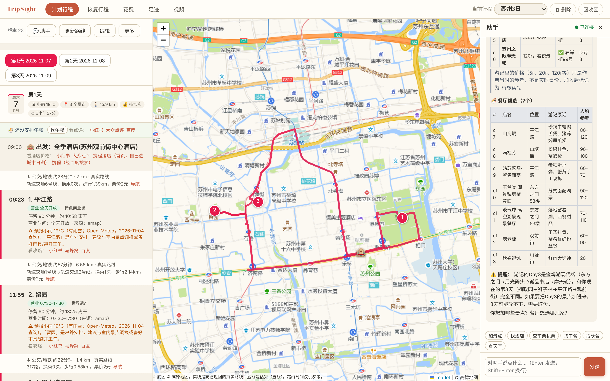
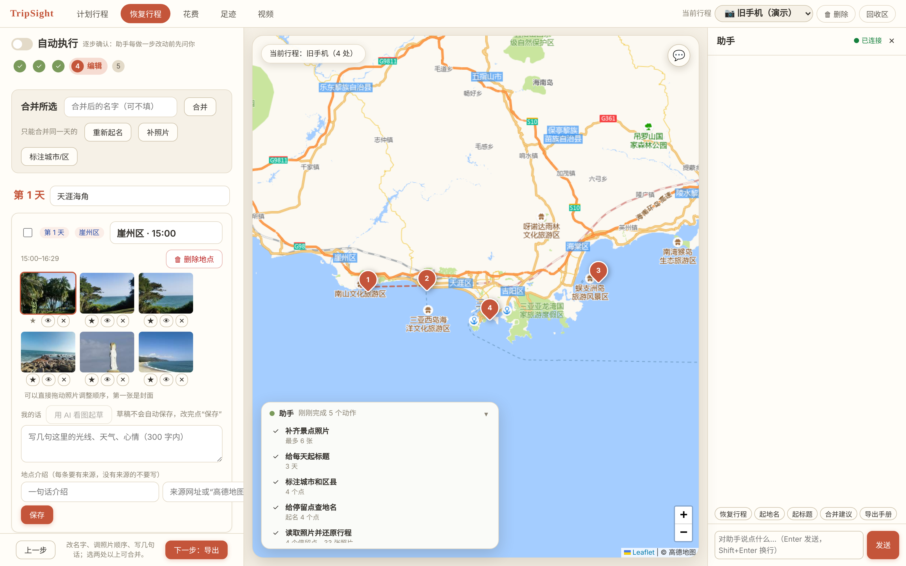
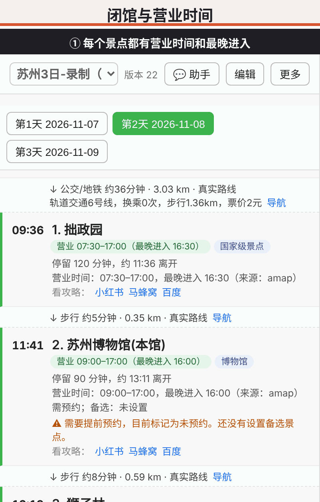
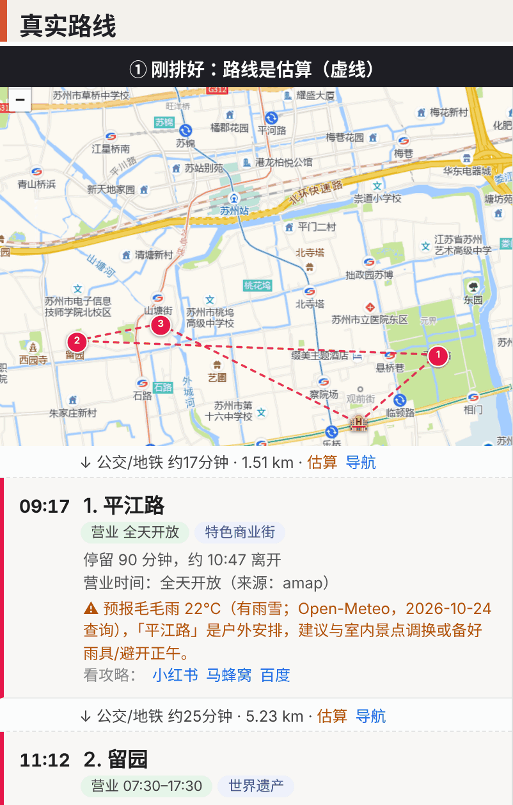
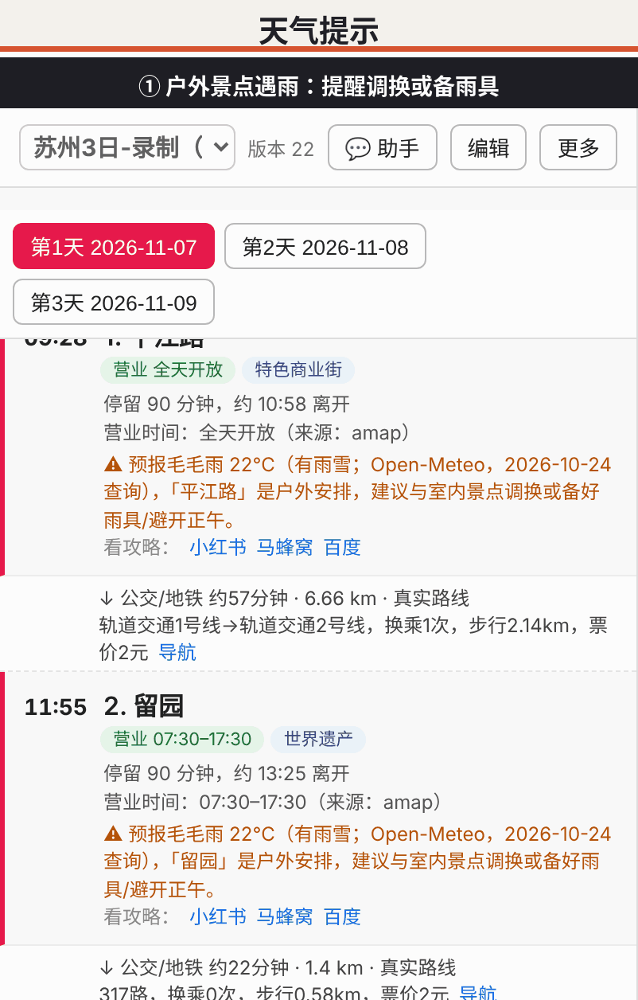
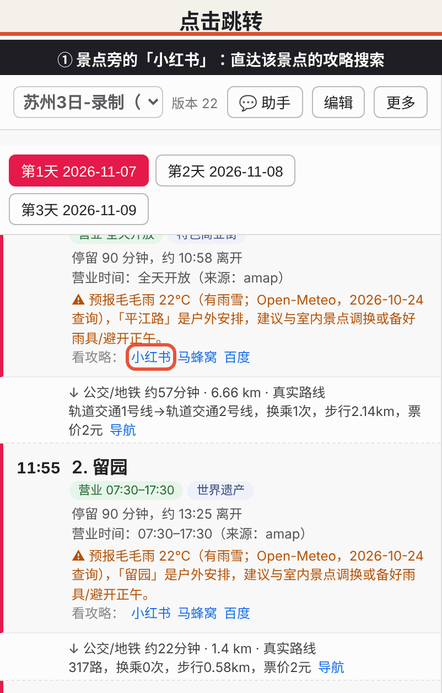
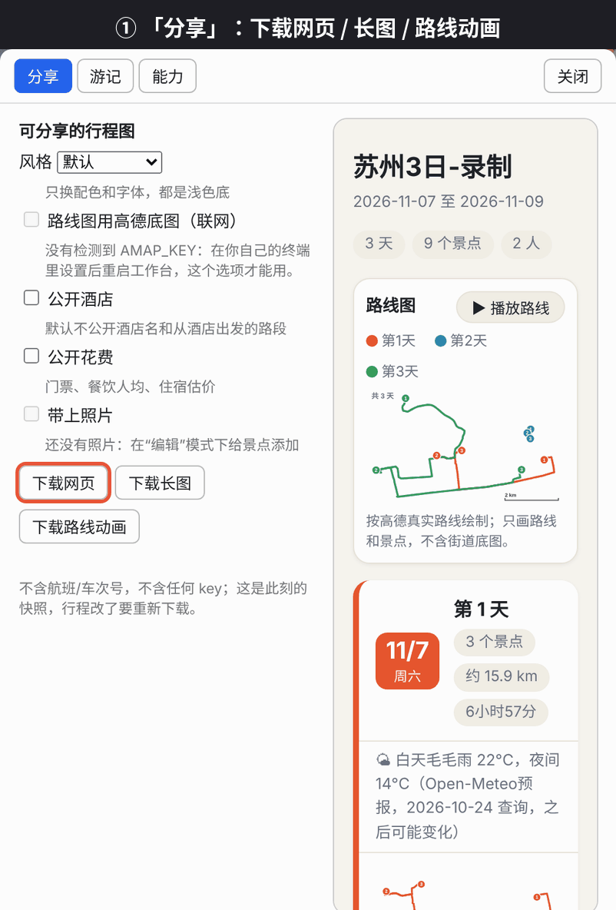
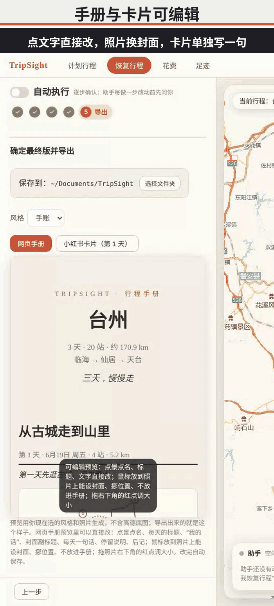
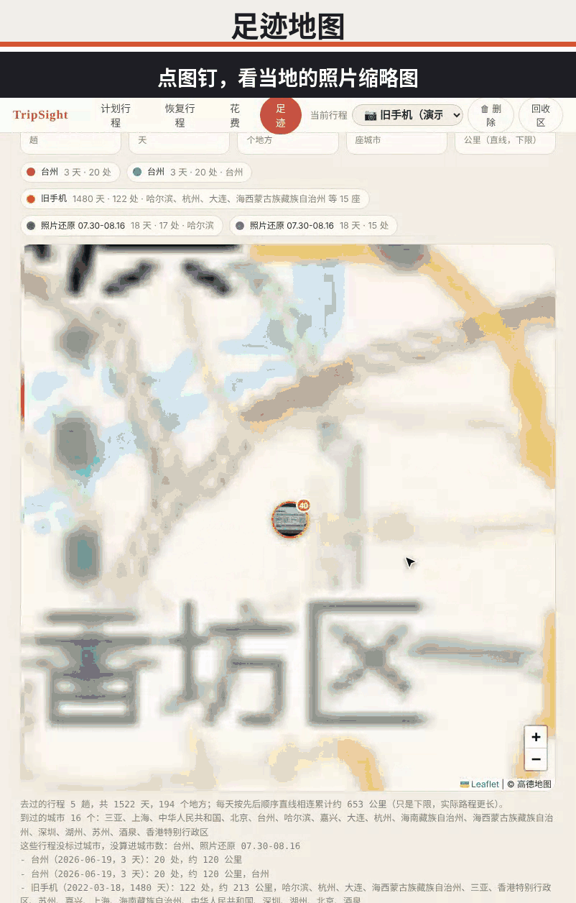
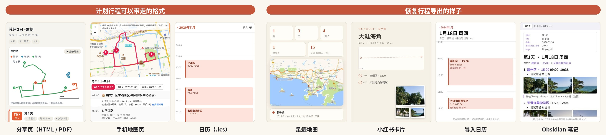

<div align="center">

<h1>🧭 TripSight</h1>

<p>
<a href="README.md">中文</a> ·
<a href="docs/SETUP.md">Setup</a> ·
<a href="DESIGN.md">Design notes</a>
</p>

<p>


</p>

<p>
<a href="docs/images/poster.jpg">

</a>
</p>

</div>

**Your all-in-one travel assistant: plan before you go, check on the road, and rebuild the trip from your photo album when you are back.**

Plug it into your own chat assistant and follow the whole trip, from before departure to after you are back:  
**plan** (real routes, opening hours, weather, arrival/departure transport, booking reminders) → **check on the road** (navigation, calendar, mobile map) → **restore the trip from your photos** (names, districts, day titles) → **handbook · cards · route animation · travel film** → **footprints and spending**.  
**Open source · data stays on your machine · every step checkable and undoable · no booking, no payment**

> **The LLM only proposes; scheduling, checking and undo are done by code.** Nothing changes until you confirm.

## ✨ What is TripSight

TripSight is an **all-in-one travel assistant**. It is not a "one-click guide generator" but a toolbox you plug into your own chat assistant: it remembers your preferences and helps you get every step right — before, during and after the trip.

| Stage | You want to… | What the agent + tools do |
|---|---|---|
| **Before · Plan** | build a reliable itinerary | Stops can come from an LLM, someone else's guide or your own wishes; all are scheduled together. Opening hours, closed days, over-packed days, weather, big transport, hotels and meals are all checked. Changes are proposals you confirm; `undo` works repeatedly |
| **On the road · Check** | know how to get there, whether it rains | Real routes for every leg (transit / walk / taxi), per-day weather (fetched automatically in the background), departure days ordered realistically (last stop → station → leave → hotel in the destination city); calendar .ics, mobile map, WeChat text, GPX |
| **After · Restore** | turn an album into the trip you walked | Rebuild stay points from a photo folder or the Mac Photos app; with "auto mode" the assistant names stops, tags city/district, titles each day and fills in photos, then stops at the preview for you |
| **Record & share** | keep it, post it | 8 share themes, web handbook, 3:4 cards, clickable PDF, per-day route animation, Obsidian notes; an optional travel film in the restore export step — clips matched to stops by time and place, with intro/outro, day title cards and animated route cards, plus an optional Jianying draft |
| **Long term** | where I went, what I spent | Footprint summary and map; WeChat/Alipay bill import for spending stats; remembered preferences |

**The agent's role** (and the design principle of the whole project):

- **The LLM only understands intent:** it hears "move Guanqian Street to the last day" or "rebuild my January photos into a trip", picks the tool, and explains in plain words. It never invents coordinates, hours or prices.
- **Deterministic code does the work:** day splitting, rule checks, routes, weather, photo clustering and exports are done by MCP tools (86 in total); facts come only from tools or you, and unknowns are marked "to verify".
- **You decide:** changes are proposals first; the assistant never books, pays or installs; trips are local JSON, the workbench listens on `127.0.0.1` only, API keys live in your own config.
- **Not tied to one model or agent:** any MCP-capable agent works (nanobot, WorkBuddy, Claude Code… see Quick start).

## 🎬 See how it works

In TripSight the **chat assistant is the operator and the web workbench is its work surface**; every step shows up in the "Assistant" card on the left — verifiable and undoable. Three flows below are **demo replays** (full videos in [`docs/videos/`](docs/videos/); click a preview to open the mp4):

<b>1. Plan a trip</b>

<p align="center"><video src="https://github.com/lvshangke/TripSight/raw/main/docs/videos/plan-flow.mp4" width="560" controls></video><br><sub>No player? <a href="docs/videos/plan-flow.mp4">Open plan-flow.mp4</a></sub></p>

<sub>One sentence becomes lookup → add stops → split into 3 days → check; a late-opening place triggers a <b>proposal</b> you must confirm; lunch and (never booked) hotel; 11 legs become real Amap routes; weather is fetched <b>automatically</b>; then export.</sub>

<b>2. Restore a trip</b>

<p align="center"><video src="https://github.com/lvshangke/TripSight/raw/main/docs/videos/restore-flow.mp4" width="560" controls></video><br><sub>No player? <a href="docs/videos/restore-flow.mp4">Open restore-flow.mp4</a></sub></p>

<sub>With "auto mode" the agent runs <b>rebuild stops → place names → city/district → day titles → photos</b> and stops at the preview; then edit and export a handbook, cards, PDF and route animation.</sub>

<b>3. Restore → Export: the optional "Travel film"</b>

<p align="center"><video src="https://github.com/lvshangke/TripSight/raw/main/docs/videos/film-flow.mp4" width="560" controls></video><br><sub>No player? <a href="docs/videos/film-flow.mp4">Open film-flow.mp4</a></sub></p>

<sub>When the album/folder contains videos, the export step shows an optional "Travel film" block: preview how clips group by stop, then generate. The agent reads only capture time, location and duration (never the picture), assigns clips to stops, and builds an intro (trip name, dates, days/places/km), a title card per day (your titles), animated route cards, place captions, cross-dissolves, the clips' original sound with normalised loudness, all in the handbook style you picked; route cards can optionally be drawn on the real Amap map along Amap driving paths (online, your own key; only map extent and neighbouring stop coordinates are sent, never stop names). The demo is driven from chat: say "group my videos by stop" and the page's clip list fills in; say "drop that short one, take only seconds 3–10 of that, caption this one" and the assistant edits clip by clip while the page follows (you can edit on the page too — same record). It ends with the final film (rendered for real from the edited clips) playing in full; the sample link below has sound. You can also ask the assistant in chat: with auto mode on, say "include the travel film" and it scans the clips and generates the film after restoring, naming, tagging districts and day titles (no path needed). No added music; a Jianying draft is optional. <a href="docs/videos/travel-film-sample.mp4"><b>▶ Watch the generated film (51 s, with sound)</b></a></sub>


<sub>These are **demo replays**: data from the real engine or real runs, played back on the real page in the real step order — **not** a live model session. Plan flow = the author's real chat transcript and trip snapshots; restore flow = the author's old-phone album (Hainan, Jan 2024, scenery only). Basemap © Amap.</sub>

| | Plan (before the trip) | Restore (after the trip) |
|---|---|---|
| You say | "3 days in Suzhou, I want Humble Administrator's Garden…" | "Rebuild my January Hainan trip from my photos" |
| Agent understands | stops, dates, pace, preferences, what to change | which album/folder, which dates, auto mode or not |
| Tools do, deterministically | day split, hours/closure/too-rushed checks, real routes, weather, versions & undo | stay-point clustering, place names, photos, handbook/cards/PDF/route animation |
| You keep control | proposals need confirmation; repeatable `undo`; never books or pays | preview before export; photos can be referenced not copied; AI text only describes what is visible |

## 🖼️ At a glance

**Left: the plan workbench** (itinerary on the left, Amap map in the middle, chat assistant on the right). **Right: the restore edit page** (album → stay points → edit → export; click a pin on the map to see that place's photo thumbnails, and the list on the left jumps to the stop).

<p>
<a href="docs/images/workbench.png"></a>&ensp;
<a href="docs/images/workbench-restore.png"></a>
</p>

**More small features**:

<p align="center">&emsp;&emsp;</p>
<p align="center">&emsp;&emsp;</p>
<p align="center">&emsp;&emsp;</p>

<sub>Screens use a demo Suzhou trip (real weather forecast) and the author's old-phone Hainan album (scenery only); basemap © Amap.</sub>

**What sharing and exporting look like**: the left three are formats you can take from a planned trip (real exports of the Suzhou demo: share page in HTML/PDF with 8 themes, a single-file phone map page, an .ics calendar — the calendar picture is rendered from the exported .ics as an illustration); the right four are exports of the three-day trip restored from the old-phone album (footprint map, Xiaohongshu card, calendar import, Obsidian note, from real export files). Chat-ready text, a GPX track and a dedicated Amap App map are also available.

<p align="center">
<a href="docs/images/export-all.jpg"></a>
</p>

## 🧩 Capabilities

| Area | What it does |
|---|---|
| **Planning** | Automatic day assignment and in-day ordering (geography + capacity + opening hours), pace levels, locking confirmed items, day-trip detection |
| **Checks** | Closed days, arriving after closing, past last entry, stay running past closing, overloaded days, long legs, missing reservations, budget, lodging too far, weather vs outdoor sights |
| **Maps & routes** | Amap / Google Maps / OpenStreetMap; real transit/walk/drive times, transfers, intercity-leg hints, airport/station transfers (late-night legs switch to taxi) |
| **Lodging & food** | Per-night / per-segment stay-area suggestions (multi-city aware), hotel candidates ranked by commute, restaurants near a stop, a named restaurant placed on the nearest day, "no lunch planned" reminders |
| **Guides → trip** | Paste a travel note or guide → every quote verified against the original text → coordinates verified on the map → you pick → added; walking routes (e.g. a city walk) can be one item |
| **Transport & weather** | Record arrival/departure flights or trains and derive first/last-day playable time; read-only flight/train/hotel reference prices; Open-Meteo and Amap weather |
| **Take it with you** | WeChat-friendly text, mobile HTML map, Amap app personal map, GPX, local web workbench |
| **Memory** | Remembers preferences you state explicitly (dislikes walking, budget cap, food) and applies them to new trips; post-trip review of actual costs and notes |
| **Engineering** | Multiple trips, version history and undo, `tripcore doctor`, Apache-2.0, 570+ automated tests |

## 🔍 Feature details

1. **Scheduling.** `schedule_days` clusters places by geography, improves the assignment with cross-day moves and swaps, and orders each day (exact search up to 7 stops, nearest-neighbour + 2-opt beyond). With known dates, opening hours are part of the cost: closed days are skipped, orders that miss closing time are penalised, and places that can never fit are reported with a reason. Locked items never move; the same input always gives the same result.
2. **Opening-hours checks.** One timeline computes the expected arrival and departure of every stop and compares it with opening hours (closed, arrives after closing, past last entry, stay beyond closing, too early, day running late). The parser is conservative: it understands forms like "Tue–Sun 09:00-17:00", "Mar–Oct" or "closed Mondays from Nov 15", and says "cannot be determined" instead of guessing.
3. **Proposals, confirmation, undo.** The assistant cannot edit the trip directly. It creates a proposal (move, remove, set status, lock, set duration) and you see "before → after" plus a 4-digit code to confirm. Every change goes into version history; applying checks the revision so nothing is overwritten.
4. **Real routes and preferences.** With an Amap key, `refine_routes` upgrades estimates to real routes (time, transfers, walking distance, fares). Preferences (max transfers, prefer subway, max walking, taxi OK) change which option is chosen; `compare_transport` compares modes and `set_leg_mode` pins one leg. Legs over ~80 km are flagged as intercity. Overseas trips can use Google Maps; without keys OpenStreetMap is the fallback.
5. **Stay areas.** `suggest_lodging` works per night: it uses the last stop of one day and the first stop of the next, merges neighbouring nights into one stay, and splits into several stays when places lie in different cities. One-day excursions (e.g. a mountain 100 km away) are detected so the hotel stays in the main area. Each segment gives a centre, radius and a "search near X" hint for the assistant.
6. **Food.** `suggest_food` searches restaurants near a stop (rating, per-person price, hours, distance); nothing is added until you choose. `find_food` places a restaurant you name on the nearest day. The workbench shows "lunch not planned" per day with a one-click "find lunch" button.
7. **Guides → candidates.** The model reads and lists; code verifies. Each candidate's quote must appear verbatim in the pasted text and contain the place name, otherwise it is rejected. Only after you pick are coordinates looked up, and only unambiguous, non-duplicate matches are added. Prices and hours in a guide are treated as unverified hints. On submit, code looks every place up on the map (when an Amap/Google key is set) and labels it matched (with address and map link) / ambiguous / not found, plus jump links to Xiaohongshu, Dianping and Mafengwo. Day markers ("Day 2", "第二天") are detected by code, so you can compare a guide's day-by-day plan with yours (`compare_with_source`, read-only) or, only when you say so, lay it out as written (`follow_source_days`: places guide day N on your day N, locks them, lists what cannot work such as closed days, one undoable version). Every place also gets an expandable "what the guide says" box holding a verbatim excerpt (max 300 characters, verified against the pasted text, marked as someone else's claim) — the model never writes it. *Input today is pasted text; there is no Xiaohongshu scraper in this repo.* Want to browse other people's guides first? `search_links` (and the "look up guides" links under every stop in the workbench; hotel rows have "check hotel prices" links to Ctrip, Dianping and Xiaohongshu — hotel prices depend on dates and room type, so pick your dates after opening; tell the assistant the price you see and it records it as user-provided) opens search pages on Xiaohongshu, Dianping, Mafengwo and others — you click and log in with your own account; TripSight never scrapes or touches your accounts. Copy a guide's text back to continue. URL formats are not verified against real accounts.
8. **Transport, weather, prices.** `set_connection` derives when the first day can start and when the last day must leave. `get_weather` covers days with confirmed dates and warns about rain or heat for outdoor sights. Flight/train/hotel reference prices use the flyai and RollingGo command-line tools through read-only skills — no booking, no payment.
9. **Take it with you.** `export_text` makes plain text for phones and chat apps (including WeChat via nanobot's `weixin` channel) with an outbound check that rejects keys and local paths; `export_map` makes a mobile-friendly HTML map; `create_amap_map` hands each day's loop to Amap's official service for a link that opens in the Amap app; `export_gpx` exports daily tracks.
10. **Web workbench.** `python -m tripcore web --open`: itinerary list, map and chat in three resizable columns. View mode shows details and problems; edit mode lets you move stops, edit stay times, add places (chosen from map search results, never typed coordinates), pick dates, switch or create trips, and preview every change before confirming. Listens on 127.0.0.1 with a one-time token, Host/Origin checks and revision checks.
11. **Preferences and review.** Preferences you explicitly state are kept across trips; after the trip you can record actual costs and notes, and `show_review` compares plan vs reality.
12. **Final checklist.** `final_check` lists everything still open: plan issues, nights without lodging, unbooked transport, stale weather, unverified data, estimated routes, days without meals. Read-only.

## 🚀 Quick start

Python 3.10 or newer is required.

```bash
git clone https://github.com/lvshangke/TripSight.git tripcore && cd tripcore
./setup.sh      # one step: venv + install + nanobot check + register + skills + self-check
                # (asks before touching your nanobot config; never installs nanobot or writes keys)
tripcore doctor # read-only self-check (never prints key values)
tripcore demo   # full demo on the sample data, no keys needed
```

**Use it in chat:** follow [docs/SETUP.md](docs/SETUP.md) (Chinese) to connect nanobot, run `nanobot`, then just say where you want to go. When you want to drag things around, see the map or export, tell the assistant **"open the workbench"** — it returns a URL with a one-time token; open it in a browser on the same computer.

**Other MCP agents:** TripSight is a standard stdio MCP server (command `tripcore-mcp`, put your own `AMAP_KEY` in its `env`) plus skills in `skills/` (`python scripts/install_skills.py --dest <your agent's skills dir>`). For WorkBuddy: Expert skills → Connectors → Add connector, paste the `mcpServers` JSON (it edits `~/.workbuddy-ai/mcp.json`), then install `skills/` into `~/.workbuddy-ai/skills`; see [docs/WORKBUDDY.md](docs/WORKBUDDY.md) (Chinese; the connector entry and config path are confirmed on a real install, other steps follow the UI). Claude Code / Claude Desktop / Cursor follow the same pattern, untested one by one.

**Workbench only:** no chat needed — `tripcore web --open`.

Keep Amap / Google keys in your own local configuration; never commit them.

<details>
<summary>Manual install, tests and Docker</summary>

```bash
python3 -m venv .venv && source .venv/bin/activate
pip install -e ".[dev]"        # provides the `tripcore` and `tripcore-mcp` commands
python -m pytest -q            # run the tests
```

**Docker (optional, not yet verified in a real environment):** the `Dockerfile` runs the CLI and the MCP server. The workbench deliberately listens on 127.0.0.1 only and is not containerised.

```bash
docker build -t tripsight .
docker run --rm tripsight python -m tripcore demo
docker run -i --rm -v "$PWD/data:/data" -e AMAP_KEY tripsight   # MCP over stdio
```

</details>

## 🏗️ Architecture and capability split

**91 MCP tools · 9 skills · 570+ automated tests**, covering plan, on the road, restore, record and footprints. The LLM only understands and proposes, tools do the work deterministically, and skills say when to use which tools and what must never be invented.

| Stage | Tools | Skills | Highlights |
|---|---|---|---|
| **Before · Plan** | 45 | `trip-planner` `trip-routes` `trip-hours-weather` `trip-food` `trip-sources` `flyai-search` | trip basics, stops and lodging, scheduling and checks, routes and transport, food, guide import (`schedule_days` `check_plan` `refine_routes` `submit_candidates`…) |
| **After · Restore** | 17 | `trip-restore` | photo restore, place names, districts, day titles, handbook (`import_photo_trip` `autoname_stops` `tag_regions` `export_handbook` `edit_handbook`…) |
| **Record & share** | 13 | `trip-export` | mobile map, WeChat text, Amap app map, calendar, GPX, share images, travel film |
| **Long term** | 15 | `trip-review` | footprints, bills and spending, review, travelogue (12); preferences (3) |

```
tripcore/   core library and MCP server (mcp_server.py: 91 tools; scheduler / validator / changes;
            amap / routemap / weather; phototrip / photoslib / stays; handbook / share / video; web + webpage: workbench)
skills/     manuals for the agent
nanobot/    example config (no secrets)
scripts/    install_skills.py · merge_nanobot_config.py
tests/  docs/
```

## 🔐 Safety

The assistant never books, pays or installs anything. The workbench is local-only with a one-time token and revision checks. Keys are read from environment variables or your local nanobot config and are never printed. Prices, hours and weather carry their source and date.

## ⚠️ Known limitations

- **Maturity:** early-stage. Amap features are tested by the author with a real key; Google Maps, the WeChat channel, the Docker image and `doctor` have limited real-world verification (automated tests mostly use fake services). How well the chat assistant follows the skill rules depends on the model and has not been systematically evaluated.
- **Data:** prices, hours, weather and ratings are reference values, not live data; public holidays and temporary closures are unknown. Opening-hours parsing is conservative and says "cannot be determined" for forms it does not understand. Without real routes, commute times are straight-line estimates (labelled as such); transit late at night (23:00–05:30) is treated as stopped and switched to taxi by a rule of thumb.
- **Cost:** only recorded items are counted — tickets, chosen restaurants, long-distance transport, lodging. Unchosen meals and local transit are not estimated.
- **Planning:** the scheduler is a heuristic (deterministic, not guaranteed optimal); pace limits are hard, so with many places and few days some are listed as unscheduled with a reason. Locked items are never moved. Stay-area suggestions are rough: when two consecutive days are far apart the suggested centre can lean towards the far side; day-trip detection uses fixed distance thresholds. "Missing lunch/dinner" uses fixed meal windows.
- **Sources:** no scraping of Xiaohongshu or other platforms — you paste guide text; the "look up" link formats are not verified against real accounts.
- **Usage:** the workbench works only on the machine running it (127.0.0.1); no multi-user or cloud sync. The assistant never books, pays or installs anything. Docs and UI are mostly Chinese.

## 📄 License

Apache License 2.0 — see [LICENSE](LICENSE).
