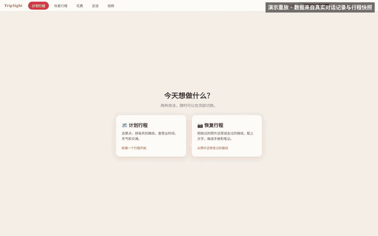
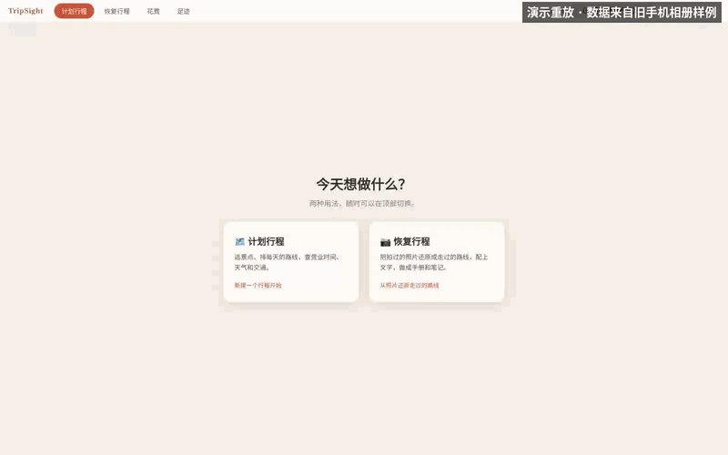
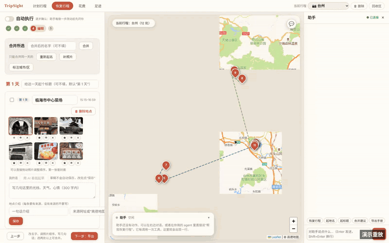
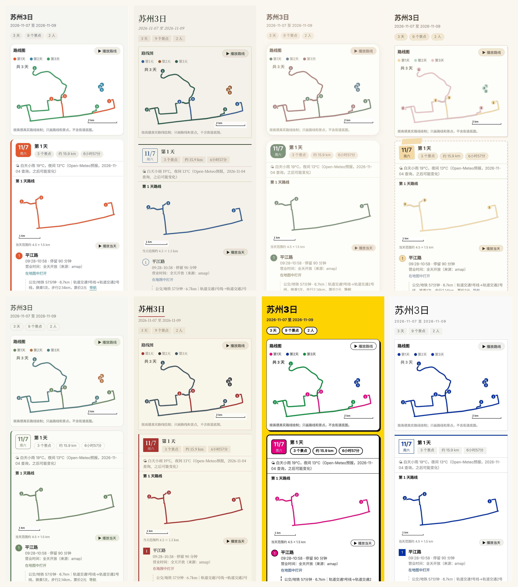
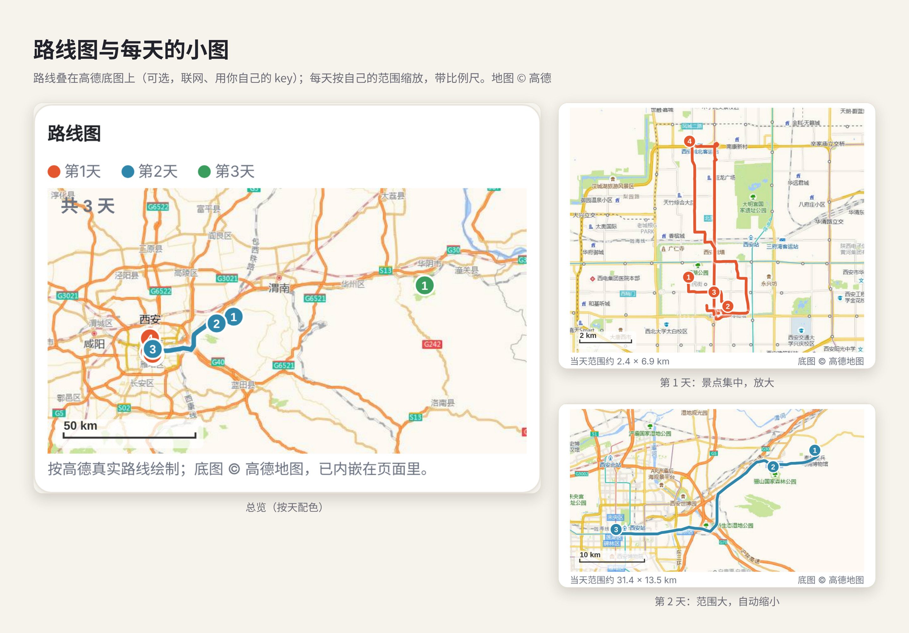

<div align="center">

<h1>🧭 TripSight</h1>

<p><b>TripSight-你的全流程旅行助手：出发前帮你排准行程，路上随时核对，回来后把相册还原成可以分享的手册。</b></p>


<p>
<a href="README.en.md">English</a> ·
<a href="docs/SETUP.md">安装与接入</a> ·
<a href="DESIGN.md">设计说明</a>
</p>

<p>


</p>

<p>
<a href="docs/images/poster.png">

</a>
</p>

<p>
接到你自己的聊天助手（MCP）里：<b>计划行程 → 路上提醒 → 恢复行程 → 记录足迹 → 分享</b>，一条线走完。<br>
<b>开源 · 数据在本机 · 每一步可核对、可撤销</b>
</p>

</div>


## ✨ TripSight 是什么

TripSight 是一个**全流程旅行助手**：它不是“一键生成攻略”，而是一个接进你自己的聊天助手、记得你偏好、陪你把每一步做准的工具箱。旅行的前、中、后它都在：

| 阶段 | 你想做的事 | TripSight 里的 Agent + 工具做什么 |
|---|---|---|
| **出发前 · 计划行程** | 排出一份靠谱的行程 | 景点从哪来都行（模型推荐、别人的攻略、你自己想去的），统一分天排序；营业时间、闭馆日、太赶、天气、大交通、住宿餐厅都参与检查；改动先出提案，你确认才生效，可连续撤销 |
| **路上 · 随时核对** | 今天怎么走、会不会下雨 | 每一段真实路线（公交/地铁/步行/打车）、每天天气（工作台打开后自动后台查）、离开日按“景点→车站→离开→目的地酒店”的真实顺序排；日历 .ics、手机版地图、微信文字、GPX |
| **回来后 · 恢复行程** | 把相册变成走过的路 | 从照片文件夹或 Mac 照片 App 的相册还原停留点；开“自动执行”后助手连续完成起名、标城市区县、起每天的标题、补景点照片，停在预览等你确认 |
| **记录与分享** | 留下来、发出去 | 8 种分享风格、网页手册、3:4 卡片、可点击 PDF、分天路线动画、Obsidian 笔记；恢复行程导出里可选「旅行短片」：视频按拍摄时间和位置归到景点，剪成带片头片尾、每天标题卡和路线动画的短片，可另生成剪映草稿 |
| **长期积累** | 去过哪、花了多少 | 足迹汇总（几趟、几个城市、大约多少公里）与足迹地图；导入微信/支付宝账单做花费统计；记住你明说过的偏好，下次自动套用 |

**Agent 在其中的角色**（也是整个项目的设计原则）：

- **LLM 只理解意图**：听懂“把观前街挪到最后一天”“把旧手机里 1 月的照片整理成行程”，决定该调哪个工具，并向你说明；它不编坐标、营业时间和价格。
- **确定性代码做事**：分天排程、规则检查、查路线和天气、聚类照片、渲染导出，都由 MCP 工具（共 86 个）完成；事实只来自工具或你，查不到就写“待核实”。
- **你保留决定权**：修改先成为提案；助手**不订票、不付款、不安装程序**；行程是本机 JSON，网页工作台只监听 `127.0.0.1`，API key 只放在你自己的配置里。
- **不绑定模型和 Agent**：任何支持 MCP 的聊天 Agent 都能接（[nanobot](https://github.com/HKUDS/nanobot)、WorkBuddy、Claude Code 等，见下方“快速开始”）。

> 满配效果（真实路线、逐条核对攻略、随时重排、预算与天气、复盘与游记、一键分享）的详细说明见 [docs/features.md](docs/features.md)。

## 🎬 看它怎么工作

TripSight 里，**聊天助手（Agent）是操作者，网页工作台是它的“工作台面”**：Agent 只负责听懂你要什么、决定调用哪个工具；排程、检查、查路线、查天气、生成导出这些都由确定性的 MCP 工具完成，每一步都出现在左侧“助手”卡片里，可核对、可撤销。下面是三条完整流程的**演示重放**（完整视频在 [`docs/videos/`](docs/videos/)，点图片可看 mp4）：

<table>
<tr>
<td width="50%" valign="top"><b>① 计划行程：说想去哪 → 助手排好、查实、串起路线</b><br><br>
<a href="docs/videos/plan-flow.mp4"></a><br>
<sub>Agent 做的事：把一句话拆成“查坐标→加景点→分 3 天→检查”；发现观前街太早到时<b>提出修改提案</b>，等你回“确认”才执行；找餐厅、记住宿（只记录不预订）；一句话把 11 段换成高德真实路线；工作台打开后<b>自动</b>补天气；最后导出分享页、PDF、日历。</sub></td>
<td width="50%" valign="top"><b>② 恢复行程：从旧手机相册还原一次走过的旅行</b><br><br>
<a href="docs/videos/restore-flow.mp4"></a><br>
<sub>Agent 做的事：打开“自动执行”后，它连续完成<b>还原停留点 → 查地名 → 标注城市/区县 → 给每天起标题 → 补景点照片</b>，停在预览等你确认；耗时步骤在后台跑，不会因工具超时中断；之后可继续编辑，并导出手册、卡片、PDF、路线动画。</sub></td>
</tr>
</table>

<p><b>③ 恢复行程 → 导出里的「旅行短片」选项</b>（真实测试：作者在台州拍的 7 段 iPhone 视频，景点名用高德反查）<br>
<a href="docs/videos/film-flow.mp4"></a>&ensp;
<a href="docs/videos/travel-film-sample.mp4"><b>▶ 查看生成的旅行短片示例（51 秒）</b></a><br>
<sub>在导出这一步，如果相册/文件夹里有视频，会多出一个可选的「旅行短片」块：先看视频怎么按景点分组，再一键生成。Agent 做的事：只读视频的拍摄时间、位置和时长（不看画面），按行程归到各景点；片头（行程名、日期、几天几处多少公里）、每天一张标题卡（用你起的标题）、画线动画的路线卡、景点名字幕条、交叉淡化，保留每段视频的原声并统一音量，版式色调跟你选的手册风格一致；路线卡可选画在真实的高德地图上、沿高德驾车路径（联网，用你自己的 key，只发地图范围和相邻景点坐标，不发景点名）；没有配乐，也可以另外生成剪映草稿。演示视频里页面操作和短片播放（带原声）是完整一条。</sub></p>

<sub>说明：这些是**演示重放**——用真实引擎生成的数据或真实运行结果（计划行程用作者的一次真实对话记录与行程快照；恢复行程用作者旧手机 2024 年 1 月海南三天的相册，只选了风景照片），在真实页面上按真实的步骤顺序回放，**不是**模型现场操作的录屏。地图为高德底图 © 高德地图。</sub>

### 两种用法，同一条原则

| | 计划行程（出发前） | 恢复行程（回来后） |
|---|---|---|
| 你说 | “去苏州 3 天，想逛拙政园、狮子林……” | “把我 1 月去海南的照片整理成行程” |
| Agent 理解 | 景点、日期、节奏、偏好、要改什么 | 从哪个相册/文件夹、哪段日期、要不要自动执行 |
| 工具确定性完成 | 分天排序、营业时间/闭馆/太赶检查、真实路线、天气、版本与撤销 | 按时间和位置聚类停留点、查地名、补照片、生成手册/卡片/PDF/路线动画 |
| 你保留的权力 | 提案先看后确认；`undo` 连续撤销；不订票不付款 | 预览后再导出；照片可只引用不复制；AI 文字只写画面里看得到的并标注 |

<details>
<summary>更早的真实对话录屏（旧版界面，助手回复未改写）</summary>

<table>
<tr>
<td width="50%" valign="top"><strong>聊天排行程</strong><br><br>
<video src="https://github.com/user-attachments/assets/a3eaa544-2bc0-4b2e-9973-f13a2541658b" width="400" controls></video></td>
<td width="50%" valign="top"><strong>粘贴攻略</strong><br><br>
<video src="https://github.com/user-attachments/assets/72cac7d6-9256-4123-ad7f-be13a17ab16a" width="400" controls></video></td>
</tr>
</table>

<sub>模型使用 Qwen3.7-Max，Harness 使用 nanobot；攻略原文来自作者粘贴的小红书帖子。</sub>
</details>

> 真实使用时有三栏：左侧行程、中间高德地图、右侧聊天助手。

## 🖼️ 效果一览

**工作台：左侧行程、中间高德地图、右侧聊天助手。** 每天一个标签，天气、营业时间、真实路线和“助手做了什么”都在一个页面里。

<a href="docs/images/workbench.png"></a>

**恢复行程：相册 → 停留点 → 编辑 → 导出。** 助手的每个动作都出现在左下角的“助手”卡片里。

<a href="docs/images/workbench-restore.png"></a>

**导出与分享：8 种风格，一键切换。** 同一份行程换个样子发给朋友或发布社交媒体；酒店和花费默认不公开，勾选才带。

<a href="docs/images/showcase-themes.jpg"></a>

**路线图：每天一张按当天范围放大的路线图**，可导出分天播放的路线动画 GIF（PDF 本身不能播放动画）。

<a href="docs/images/showcase-routes.jpg"></a>

<sub>图中为演示用的苏州 3 日行程（天气为真实预报）和作者旧手机的海南相册（只选风景）；底图 © 高德地图。以上截图为演示重放生成。</sub>

## 🔁 一次规划的流程

1. **说想去哪**：聊天里报目的地、日期、人数、节奏；或在网页里点“新建行程”填表。
2. **收集景点**：直接说景点名；让助手**推荐**；或把**别人的攻略/游记**整段贴进来，逐条核对后挑选；也可以加**你自己想去**的任何地方。三种来源统一排程。
3. **自动分天**：按地理位置和营业时间把景点分到每一天，排好顺序。
4. **核对和细化**：查高德真实路线、检查是否太赶/闭馆/没预约，选酒店、找餐厅、看天气。
5. **随时调整**：拖动、对话、改时长都行，改完自动检查，不满意一键撤销。
6. **一键串起全程路线，带走行程**：补全所有真实路线，生成高德 App 专属地图（每天一个闭环）、手机版地图页、微信里能直接发的文字或 GPX 轨迹。

## 🧩 已经落地的能力

| 能力 | 内容 |
|---|---|
| **规划** | 自动分天与天内排序（地理 + 容量 + 营业时间）、节奏（悠闲/适中/紧凑）、锁定已确认的安排、一日游识别 |
| **核查** | 闭馆日、到达时已关门、过了最晚进入、停留超过闭馆、太赶、路上太久、没预约、超预算、住宿太远、天气不适合户外 |
| **地图与路线** | 高德 / Google Maps / OpenStreetMap；真实路线时间、换乘与步行距离、跨城路段提示、机场车站接驳（含夜间改打车） |
| **住宿与用餐** | 按每晚/每段推荐住在哪一带（跨城市自动分段）、候选酒店按通勤排序、沿途餐厅搜索、指定店铺就近安排、每天缺几顿饭的提醒 |
| **攻略转行程** | 粘贴游记/攻略 → 原文逐字核对 → 提交时自动查高德（已匹配/有歧义/没找到）并附跳转链接 → 你挑选后加入；识别“第N天/Day N”，可对照或照搬游记的分天；每个景点带可展开的游记原文；顺路路线（如 citywalk）可整条作为一项 |
| **大交通与天气** | 记录到达/离开的航班或火车并推算首末日可玩时间；机票/火车票/酒店参考价（只读查询）；高德与 Open-Meteo 天气预报（工作台打开时，预报范围内的天自动后台查，每天顶部、分享页、手册、日历都带天气）；离开日按真实顺序排：最后一个景点 → 车站 → 离开，当晚在目的地城市的酒店放在到站之后 |
| **带走行程** | 微信文字版、手机版 HTML 地图、高德 App 专属地图、GPX、本机网页工作台 |
| **旅行后：照片还原与手册** | 从照片文件夹或 Mac 照片 App 的相册还原走过的行程（按时间和位置聚成停留点，可合并、改名，可用 GPX/KML 轨迹给没定位的照片补位置）；可跨多年、也可按日期范围只还原一段；**自动模式**（工作台里一键开关）下助手连续完成导入、起名、标注城市、补照片，到预览停下等你点导出，期间页面左侧跟着助手的动作变化，起名等耗时步骤在后台跑，不会因工具超时中断；每个景点最多 6 张照片，可只引用不复制；生成网页手册、每天一张 3:4 卡片（照片大小可调）、PDF、**可点击的长页面 PDF**（路线“导航”链接手机上直接点）、Obsidian 笔记，多种版式，每天一张按当天范围放大的路线图，可导出分天播放的路线动画 GIF（PDF 本身不能播放动画），路线图可加高德底图、按交通方式区分线型、用缩略图当图钉；照片内容的文字描写只写画面里看得到的，标明是 AI 写的 |
| **花费** | 导入微信 / 支付宝账单（本机解析，内容不交给模型），自动盯着文件夹（含 iCloud 云盘）导入，iPhone 快捷指令记 Apple Pay；按类别统计、可改类别并记住商户，可选放进手册后记 |
| **视频与足迹** | 视频按拍摄时间和位置归到景点，按行程顺序剪成旅行短片（片头片尾、每天标题卡、路线动画、景点字幕，不加音乐；成片尺寸跟随素材分辨率），可同时生成剪映草稿；足迹汇总去过几趟、几个城市、大约多少公里，并画足迹地图 |
| **长期记忆** | 记住你明说过的偏好（不爱走路、不吃辣、住宿预算），新行程自动套用；旅行后记录实际花费与评价，给出偏好建议 |
| **工程** | 多行程管理、版本历史与撤销、`tripcore doctor` 自检、Apache-2.0、570+ 个自动化测试 |

## 🔎 数据来源与验证程度

> - ✅ **已用真实 key 测试**：高德地图（路线、营业时间、坐标核实、天气）。
> - 🌤️ **天气**：国内优先用高德天气（约未来 4 天），高德没有的日期或境外用 [Open-Meteo](https://open-meteo.com/)（免费，无需 key，最长约 16 天）。每条预报都标明来源和查询日期。
> - 💰 **价格（只读查询）**：机票、火车票、酒店参考价通过技能调用 [飞猪 FlyAI](https://github.com/alibaba-flyai/flyai-skill) 和 [RollingGo](https://clawhub.ai/rollinggo-ai/skills/rollinggo-search-hotel-skill) 的命令行获得，只查询，价格都标注来源和日期。
> - ⚠️ **验证有限**：Google Maps、微信渠道等接入已进行自动化测试，真实环境验证有限。
> - 价格、营业时间、天气均为参考值，出行前请以官方信息为准。
> 助手**不会**订票、订酒店或付款。

## 🏗️ 架构

```
聊天 Agent（LLM，如 nanobot）  ──提案──▶  tripcore MCP 服务  ──▶  trip.json（版本化、可撤销）
   只理解意图、提出修改                     排程 · 检查 · 版本 · 路线
                                           事实只来自工具或用户
网页工作台（127.0.0.1）  ─────────────────────────▲
```

- `tripcore/` 是核心库和 MCP 服务；`skills/` 是给 Agent 的“说明书”（流程与铁律）；`nanobot/config.example.json` 是接入配置样例（不含密钥）；`scripts/install_skills.py` 把技能安装进 nanobot。
- nanobot 不在本仓库里，由你自己安装；仓库只提供接入所需的技能、配置样例和脚本，这样升级 nanobot 不会和本项目冲突。

## 🔐 安全原则

- 助手**不订票、不付款、不安装程序**；价格查询只用只读命令。
- 网页工作台只监听本机，带一次性令牌，所有写入带版本号校验。
- API key 只从环境变量或你本机的 nanobot 配置读取；`tripcore doctor` 只报告“已配置/未配置”；导出文字前会拒绝含 key 或本机路径的内容。
- 价格、营业时间、天气都带来源和日期，拿不准就明说，不编。

## 🚀 快速开始

TripSight 是一个标准的 MCP 服务：**模型负责听懂你，TripSight 负责排准、查实、留好退路**。所以先装好它，再接到你用的聊天 Agent 里。

**1. 安装**（需要 Python 3.10 或更新版本）

```bash
git clone https://github.com/lvshangke/TripSight.git tripcore && cd tripcore
pip install -e .   # 装好后有 tripcore、tripcore-mcp 两个命令
tripcore demo      # 不需要任何 key 和模型，先用示例数据完整演示一遍
```

**2. 接到你的聊天 Agent**

| Agent | 做法 | 状态 |
|---|---|---|
| [nanobot](https://github.com/HKUDS/nanobot) | 运行 `./setup.sh`：创建环境、登记 tripcore、安装技能、自检（改配置前会先让你确认），详见 [docs/SETUP.md](docs/SETUP.md) | 作者在用，已测试 |
| [WorkBuddy](https://www.workbuddy.ai) | 在“连接 → 自定义连接 → Configure MCP”里登记 `tripcore-mcp`，再把 `skills/` 装进 `~/.workbuddy/skills`，详见 [docs/WORKBUDDY.md](docs/WORKBUDDY.md) | 按其官方 MCP 配置方式整理，**未在真实环境验证** |
| Claude Code / Claude Desktop / Cursor 等支持 MCP 的 Agent | 在它的 MCP 配置里添加一个 stdio 服务：命令 `tripcore-mcp`，环境变量放你自己的 `AMAP_KEY`；再安装 `skills/` 里的技能（`python scripts/install_skills.py`：`trip-planner` 常驻，其余 6 个按场景触发时才读），助手才知道该按什么流程使用这 86 个工具；嫌工具说明占上下文，可设 `TRIPCORE_TOOLS=core`，其余功能由技能指引、用 `tripcore run` 命令行调用（见 [docs/reference.md](docs/reference.md)） | 按 MCP 标准接入，**未逐个测试** |

`tripcore doctor` 会检查依赖、技能、Agent 和 key 是否就绪（只读，不显示 key）。高德 / Google key 只放在你自己本机的配置里，不要提交到仓库。

**3. 开始用**

运行你的 Agent，直接说想去哪、想怎么玩。想拖动调整、看地图或导出时，对助手说 **“打开工作台”**，它会返回一个带一次性令牌的网址，在这台电脑的浏览器里打开即可。

> 暂时不想接模型？`tripcore web --open` 可以单独打开网页工作台，用于拖动调整、检查和导出；一句话加景点、粘贴攻略这类功能需要接入聊天 Agent。

手动安装、Docker、命令行和代码结构见 [docs/reference.md](docs/reference.md)。

## 📚 更多文档

- [docs/SETUP.md](docs/SETUP.md)：安装、接入 nanobot、微信、Google Maps
- [docs/WORKBUDDY.md](docs/WORKBUDDY.md)：接入 WorkBuddy
- [docs/features.md](docs/features.md)：功能详解与“满配效果”
- [docs/reference.md](docs/reference.md)：命令行、行程数据格式、代码结构、MCP 工具与接口详解
- [docs/limitations.md](docs/limitations.md)：已知局限与后续计划
- [docs/TOOLS.md](docs/TOOLS.md)：全部 86 个工具清单
- [DESIGN.md](DESIGN.md)：设计原则与算法

## 📄 许可证

Apache License 2.0，见 [LICENSE](LICENSE)。

