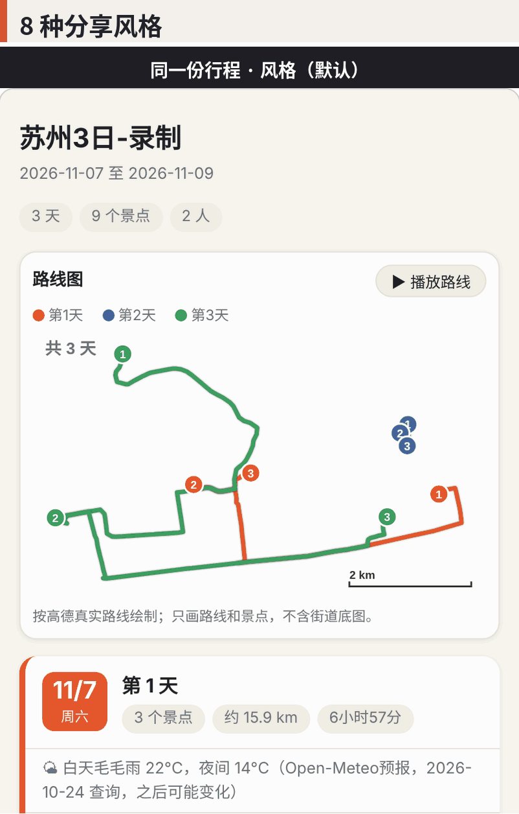
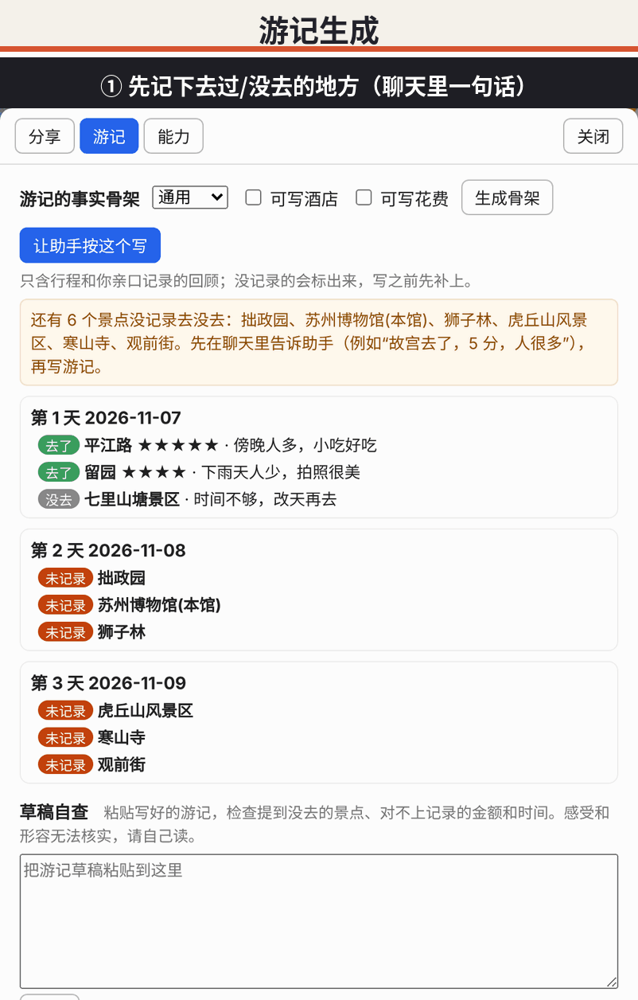
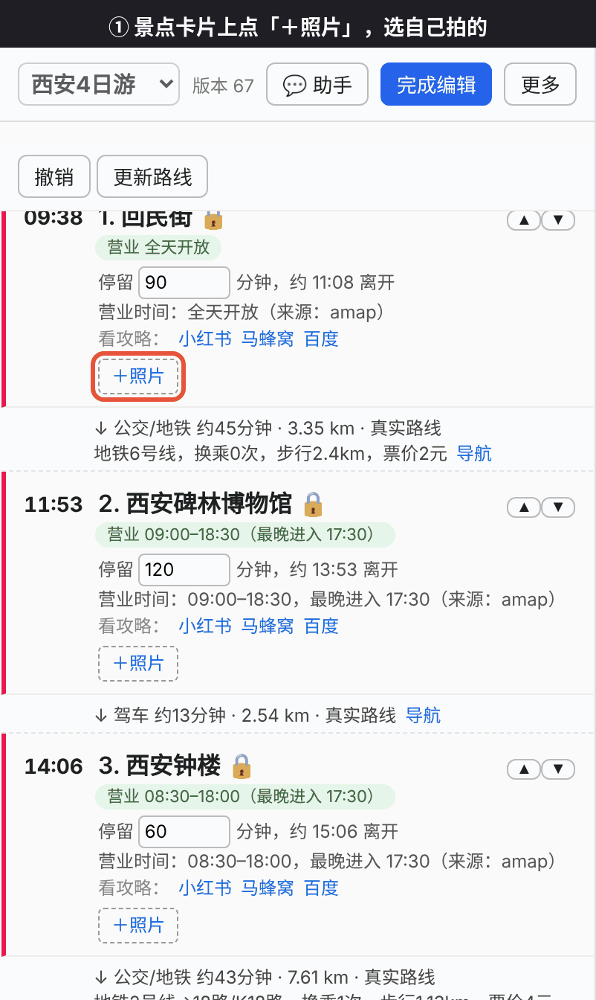

<div align="center">

<h1>🧭 TripSight</h1>

<p><b>不是一键生成攻略，而是一个记得你、陪你一步步把行程排准的旅行助手。</b></p>


<p>
<a href="README.en.md">English</a> ·
<a href="docs/SETUP.md">安装与接入</a> ·
<a href="DESIGN.md">设计说明</a>
</p>

<p>


</p>

<p>
<a href="docs/images/poster.png">

</a>
</p>

<p>
接到你自己的聊天助手里，把行程一步步排准。<br>
<b>开源 · 数据在本机 · 每一步可核对、可撤销</b>
</p>

</div>


## 核心功能

<!-- <p><b>核心功能</b></p> -->


<p><b>规划与检查</b></p>
<p>&ensp;&ensp;</p>

<p><b>出行前后随时可用</b></p>
<p>&ensp;&ensp;</p>

<p><b>回程之后：一键分享发布</b></p>
<p>&ensp;&ensp;&ensp;</p>


<!-- <div align="center">

<p><b>核心功能</b></p>

<p><b>规划与检查</b></p>
<p>
&ensp;
&ensp;

</p>

<p><b>出行前后随时可用</b></p>
<p>
&ensp;
&ensp;

</p>

<p><b>回程之后：一键分享发布</b></p>
<p>
&ensp;
&ensp;
&ensp;

</p>

</div> -->

> 演示用北京、苏州示例行程和西安回民街；天气是真实预报，游记里的记录是演示用示例数据。真实使用时有三栏：左侧行程、中间高德地图、右侧聊天助手。

## ✨ TripSight 是什么

<!-- 照着别人的攻略出行，常卡在这几件事上：攻略不包含你的酒店、抵离时间和季节；你自己想去的地方很难融进去；景点之间怎么走要一段段反复查；大模型直接生成的行程会一本正经地编，改一处还可能乱全盘。 -->
照着别人的攻略出行，往往在这几件事上卡住：

1. **别人的攻略不全。** 一篇攻略通常只讲“去哪玩”，不会包含你的整个行程：**酒店住哪里、几点抵达、几点离开**、你是**哪个季节**去的——这些恰恰决定了第一天能玩多久、最后一天能排什么、景点开不开门、天气适不适合。照搬下来，常常到了现场才发现来不及、关门了或者住得太远。
2. **个人特色很难融进去。** 你自己想去的小店、朋友推荐的地方、要陪家人的节奏、不爱走路的习惯，别人的攻略里都没有；手工往里塞，又得重新排顺序、重新算路程。
3. **景点之间怎么走，要反复查。** 每两个点之间走路、公交还是打车，得一段一段打开地图软件查，改一次行程就重查一遍，既重复又容易漏。
4. **大模型直接生成的行程不可靠。** 它会一本正经地编：景点早已闭馆、两地相隔两小时说成“顺路”，改一处还可能乱全盘。

TripSight 把它们拆开解决：

- **景点从哪来都行**：大模型推荐、别人的攻略（贴正文，逐条核对后挑选）、你自己想去的，统一排进同一份行程；酒店、到达和离开的大交通、日期和季节也直接参与分天和营业时间检查。
- **事实不靠编**：坐标、营业时间、路线、天气只来自地图服务和工具，查不到就写“待核实”；营业时间在分天和排序时就会避开闭馆日。
- **每一步可确认、可撤销**：大模型只听懂意图、提出修改；排程、检查、查路线、记版本由确定性代码（通过 MCP 提供 63 个工具）完成；所有修改先成为提案，你确认才生效，`undo` 可连续撤销。
- **路线不用反复查**：配置高德后一次补全每一段真实路线，再一键生成每天串联好的专属地图。
- **不绑定模型，数据在你电脑上**：任何支持 MCP 的聊天 Agent 都能接（仓库附带 [nanobot](https://github.com/HKUDS/nanobot) 的接入配置）；行程是本机 JSON，网页工作台只监听 `127.0.0.1`，API key 只放在你自己的配置里。

> 满配效果（真实路线、逐条核对攻略、随时重排、预算与天气、复盘与游记、一键分享）的详细说明见 [docs/features.md](docs/features.md)。

## 🖼️ 效果一览

**聊天排行程。** 一句话让助手加景点、排成 3 天；改动先出提案，你说“确认”才执行；住宿只记录、不预订；最后一句话把每一段换成高德真实路线。行程栏、地图和聊天同步变化。

**粘贴别人的攻略。** 把一篇小红书攻略贴给助手：已有的景点跳过，新的逐条核对并列成候选（不会直接加入），你挑选后它去高德核对真实店名和营业时间，确认后才加入并重排；放不下的会明说。
<table>
<tr>
<td width="50%" valign="top"><strong>聊天排行程</strong><br><br>
<video src="https://github.com/user-attachments/assets/a3eaa544-2bc0-4b2e-9973-f13a2541658b" width="400" controls></video></td>
<td width="50%" valign="top"><strong>粘贴攻略</strong><br><br>
<video src="https://github.com/user-attachments/assets/72cac7d6-9256-4123-ad7f-be13a17ab16a" width="400" controls></video></td>
</tr>
</table>

<sub>以上对话和行程是真实运行的记录（助手的回复没有改写，模型使用Qwen3.7-Max,Harness使用nanobot），地图为高德底图 © 高德地图；攻略原文来自作者粘贴的小红书帖子。</sub>

<!-- **8 种分享风格，一键切换。** 同一份行程换个样子发给朋友或发布社交媒体；酒店和花费默认不公开，勾选才带。 -->

<a href="docs/images/showcase-themes.jpg"></a>

<!-- **路线图叠在高德底图上。** 分享页自带内联 SVG 路线图，可导出路线动画 GIF；可选联网叠加高德底图（用你自己的 `AMAP_KEY`，页面仍是单文件）。 -->

<a href="docs/images/showcase-routes.jpg"></a>


<sub>图中行程是作者自己的测试行程（西安、京都、杭州、哈尔滨），营业时间来自高德；底图 © 高德地图。</sub>

## 🔁 一次规划的流程

1. **说想去哪**：聊天里报目的地、日期、人数、节奏；或在网页里点“新建行程”填表。
2. **收集景点**：直接说景点名；让助手**推荐**；或把**别人的攻略/游记**整段贴进来，逐条核对后挑选；也可以加**你自己想去**的任何地方。三种来源统一排程。
3. **自动分天**：按地理位置和营业时间把景点分到每一天，排好顺序。
4. **核对和细化**：查高德真实路线、检查是否太赶/闭馆/没预约，选酒店、找餐厅、看天气。
5. **随时调整**：拖动、对话、改时长都行，改完自动检查，不满意一键撤销。
6. **一键串起全程路线，带走行程**：补全所有真实路线，生成高德 App 专属地图（每天一个闭环）、手机版地图页、微信里能直接发的文字或 GPX 轨迹。

## 🧩 已经落地的能力

| 能力 | 内容 |
|---|---|
| **规划** | 自动分天与天内排序（地理 + 容量 + 营业时间）、节奏（悠闲/适中/紧凑）、锁定已确认的安排、一日游识别 |
| **核查** | 闭馆日、到达时已关门、过了最晚进入、停留超过闭馆、太赶、路上太久、没预约、超预算、住宿太远、天气不适合户外 |
| **地图与路线** | 高德 / Google Maps / OpenStreetMap；真实路线时间、换乘与步行距离、跨城路段提示、机场车站接驳（含夜间改打车） |
| **住宿与用餐** | 按每晚/每段推荐住在哪一带（跨城市自动分段）、候选酒店按通勤排序、沿途餐厅搜索、指定店铺就近安排、每天缺几顿饭的提醒 |
| **攻略转行程** | 粘贴游记/攻略 → 原文逐字核对 → 提交时自动查高德（已匹配/有歧义/没找到）并附跳转链接 → 你挑选后加入；识别“第N天/Day N”，可对照或照搬游记的分天；每个景点带可展开的游记原文；顺路路线（如 citywalk）可整条作为一项 |
| **大交通与天气** | 记录到达/离开的航班或火车并推算首末日可玩时间；机票/火车票/酒店参考价（只读查询）；Open-Meteo 与高德天气预报 |
| **带走行程** | 微信文字版、手机版 HTML 地图、高德 App 专属地图、GPX、本机网页工作台 |
| **长期记忆** | 记住你明说过的偏好（不爱走路、不吃辣、住宿预算），新行程自动套用；旅行后记录实际花费与评价，给出偏好建议 |
| **工程** | 多行程管理、版本历史与撤销、`tripcore doctor` 自检、Apache-2.0、444 个自动化测试 |

## 🔎 数据来源与验证程度

> - ✅ **已用真实 key 测试**：高德地图（路线、营业时间、坐标核实、天气）。
> - 🌤️ **天气**：国内优先用高德天气（约未来 4 天），高德没有的日期或境外用 [Open-Meteo](https://open-meteo.com/)（免费，无需 key，最长约 16 天）。每条预报都标明来源和查询日期。
> - 💰 **价格（只读查询）**：机票、火车票、酒店参考价通过技能调用 [飞猪 FlyAI](https://github.com/alibaba-flyai/flyai-skill) 和 [RollingGo](https://clawhub.ai/rollinggo-ai/skills/rollinggo-search-hotel-skill) 的命令行获得，只查询，价格都标注来源和日期。
> - ⚠️ **验证有限**：Google Maps、微信渠道等接入已进行自动化测试，真实环境验证有限。
> - 价格、营业时间、天气均为参考值，出行前请以官方信息为准。
> 助手**不会**订票、订酒店或付款。

## 🏗️ 架构

```
聊天 Agent（LLM，如 nanobot）  ──提案──▶  tripcore MCP 服务  ──▶  trip.json（版本化、可撤销）
   只理解意图、提出修改                     排程 · 检查 · 版本 · 路线
                                           事实只来自工具或用户
网页工作台（127.0.0.1）  ─────────────────────────▲
```

- `tripcore/` 是核心库和 MCP 服务；`skills/` 是给 Agent 的“说明书”（流程与铁律）；`nanobot/config.example.json` 是接入配置样例（不含密钥）；`scripts/install_skills.py` 把技能安装进 nanobot。
- nanobot 不在本仓库里，由你自己安装；仓库只提供接入所需的技能、配置样例和脚本，这样升级 nanobot 不会和本项目冲突。

## 🔐 安全原则

- 助手**不订票、不付款、不安装程序**；价格查询只用只读命令。
- 网页工作台只监听本机，带一次性令牌，所有写入带版本号校验。
- API key 只从环境变量或你本机的 nanobot 配置读取；`tripcore doctor` 只报告“已配置/未配置”；导出文字前会拒绝含 key 或本机路径的内容。
- 价格、营业时间、天气都带来源和日期，拿不准就明说，不编。

## 🚀 快速开始

TripSight 是一个标准的 MCP 服务：**模型负责听懂你，TripSight 负责排准、查实、留好退路**。所以先装好它，再接到你用的聊天 Agent 里。

**1. 安装**（需要 Python 3.10 或更新版本）

```bash
git clone https://github.com/lvshangke/TripSight.git tripcore && cd tripcore
pip install -e .   # 装好后有 tripcore、tripcore-mcp 两个命令
tripcore demo      # 不需要任何 key 和模型，先用示例数据完整演示一遍
```

**2. 接到你的聊天 Agent**

| Agent | 做法 | 状态 |
|---|---|---|
| [nanobot](https://github.com/HKUDS/nanobot) | 运行 `./setup.sh`：创建环境、登记 tripcore、安装技能、自检（改配置前会先让你确认），详见 [docs/SETUP.md](docs/SETUP.md) | 作者在用，已测试 |
| Claude Code / Claude Desktop / Cursor 等支持 MCP 的 Agent | 在它的 MCP 配置里添加一个 stdio 服务：命令 `tripcore-mcp`，环境变量放你自己的 `AMAP_KEY`；再让它读 `skills/trip-planner/SKILL.md`，助手才知道该按什么流程使用这 63 个工具 | 按 MCP 标准接入，**未逐个测试** |

`tripcore doctor` 会检查依赖、技能、Agent 和 key 是否就绪（只读，不显示 key）。高德 / Google key 只放在你自己本机的配置里，不要提交到仓库。

**3. 开始用**

运行你的 Agent，直接说想去哪、想怎么玩。想拖动调整、看地图或导出时，对助手说 **“打开工作台”**，它会返回一个带一次性令牌的网址，在这台电脑的浏览器里打开即可。

> 暂时不想接模型？`tripcore web --open` 可以单独打开网页工作台，用于拖动调整、检查和导出；一句话加景点、粘贴攻略这类功能需要接入聊天 Agent。

手动安装、Docker、命令行和代码结构见 [docs/reference.md](docs/reference.md)。

## 📚 更多文档

- [docs/SETUP.md](docs/SETUP.md)：安装、接入 nanobot、微信、Google Maps
- [docs/features.md](docs/features.md)：功能详解与“满配效果”
- [docs/reference.md](docs/reference.md)：命令行、行程数据格式、代码结构、MCP 工具与接口详解
- [docs/limitations.md](docs/limitations.md)：已知局限与后续计划
- [docs/TOOLS.md](docs/TOOLS.md)：全部 63 个工具清单
- [DESIGN.md](DESIGN.md)：设计原则与算法

## 📄 许可证

Apache License 2.0，见 [LICENSE](LICENSE)。

