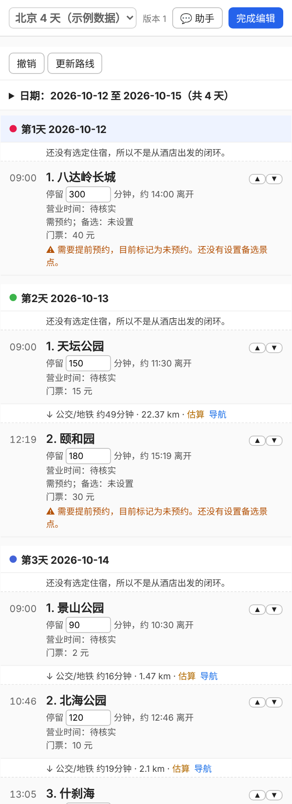

# TripSight（tripcore）—— 可靠的旅行行程规划 Agent

[English](README.en.md) · 许可证：[Apache-2.0](LICENSE)

让大模型**只负责听懂你的意思、提出修改**，由确定性的代码来**排程、检查、记版本、撤销**；地点、时间、路线等事实只来自地图服务、工具或你本人，不靠模型编。



*本机网页工作台的行程列表（编辑模式，示例数据）：每个景点可直接改停留时长、上下移动，景点之间显示通勤，需预约等问题直接标在景点下面。右侧还有地图和聊天助手，截图里没放。*

## 能做什么

- 把一批想去的景点按地理位置和**营业时间**自动分到每一天，并排好游览顺序；
- 估算或（配置高德/Google 后）查询真实路线与通勤时间；
- 检查问题：太赶、闭馆、到达时已关门、没预约、路上太久、天气不适合户外……
- 所有修改先成为“提案”，确认后才生效，可撤销；已确认的安排会锁定，不会被自动重排打乱；
- 本机网页工作台：切换/新建行程、拖动调整、加景点、改停留时长、地图和聊天助手；
- 通过 MCP 接入聊天 Agent（nanobot）：用对话加景点、选酒店、查车票机票（只读，不预订不支付）。

## 快速开始

需要 Python 3.10 或更新版本。

```bash
git clone https://github.com/lvshangke/TripSight.git tripcore && cd tripcore
python3 -m venv .venv && source .venv/bin/activate
pip install -r requirements.txt

python -m tripcore doctor     # 自检：依赖、技能、nanobot、key 是否就绪（只读，不显示 key）
python -m tripcore demo       # 用示例数据完整演示一遍
python -m tripcore web --open # 打开本机网页工作台
python -m pytest -q           # 运行测试
```

要在聊天里使用，请按 [docs/SETUP.md](docs/SETUP.md) 接入 nanobot。高德/Google key 只放在你自己本机的配置里，不要提交到仓库。

> 下面的“第一次运行”等章节是更详细的参考文档，部分描述写于早期里程碑，具体以 `DESIGN.md` 和各 MCP 工具的说明为准。

---

> **接入聊天 Agent（nanobot）**：见 [docs/SETUP.md](docs/SETUP.md)。仓库里的 `skills/` 是给 nanobot 用的说明书，`scripts/install_skills.py` 负责安装，`nanobot/config.example.json` 是配置样例（不含密钥）。

## 一、第一次运行（约 5 分钟）

需要 Python 3.10 或更新版本（本项目在 Python 3.12 上测试通过）。

```bash
# 1. 进入项目文件夹
cd tripcore

# 2.（推荐）创建独立环境，避免污染系统
python3 -m venv .venv
source .venv/bin/activate          # Windows 用：.venv\Scripts\activate

# 3. 安装依赖
pip install -r requirements.txt

# 4. 运行完整演示
python -m tripcore demo

# 5. 运行测试（应显示全部通过）
python -m pytest -q
```

> Windows 上如果 `python3` 不可用，请改用 `python`。

`demo` 会用 `examples/beijing.json` 演示完整流程：分天 → 检查 → 推荐住宿 → 选定住宿后重新安排。
**示例里的坐标、闭馆日、预约信息都是近似值，只用于演示，真实出行请以官方信息为准。**

---

## 二、常用命令

```bash
# 读取你自己的 JSON，自动分天并检查
python -m tripcore plan examples/beijing.json

# 指定节奏 / 交通方式 / 住宿，并把结果保存下来
python -m tripcore plan examples/beijing.json --pace relaxed --mode transit --lodging hotel_qianmen --out my_trip.json

# 检查一个已保存的行程
python -m tripcore check my_trip.json

# 撤销最近一次修改（会直接改写这个文件）
python -m tripcore undo my_trip.json

# 查某个地名的经纬度（需要联网，用的是 OpenStreetMap 的免费服务）
export TRIPCORE_CONTACT="你的邮箱或项目地址"   # 使用政策要求带上可联系的标识
python -m tripcore geocode "故宫博物院" --city 北京
```

---

## 三、怎么写你自己的行程（JSON）

复制 `examples/beijing.json`，改成你自己的。关键字段：

**meta（整体设置）**

| 字段 | 含义 |
|---|---|
| `date_mode` | `exact` 日期已定 / `range` 只有范围 / `unknown` 还没定 |
| `start_date` `end_date` | 日期已定时填写，天数由它们决定 |
| `num_days` | 日期没定时填写天数 |
| `pace` | `relaxed` 悠闲（每天 ≤2 个）/ `normal`（≤3 个）/ `packed`（≤5 个） |
| `mode` | 交通偏好：`walk` / `transit` / `drive` |
| `budget_total` | 总预算，可不填 |

**places（景点）**

| 字段 | 含义 |
|---|---|
| `id` | 唯一标识，英文或拼音，不能重复 |
| `name` `lat` `lon` | 名称、纬度、经度（WGS84） |
| `status` | `idea` 想法 / `shortlist` 入围（默认）/ `planned` 已安排 / `confirmed` 已确认 / `excluded` 排除。其中 `shortlist`、`planned`、`confirmed` 会参与自动分天；`idea` 和 `excluded` 不会 |
| `duration_min` | 预计游览分钟数 |
| `priority` | 重要程度 1~5，名额不够时优先保留高的 |
| `must_go` | 必去。必去景点即使放不下也会硬塞进去，并由检查提醒“太满” |
| `closed_weekdays` | 每周闭馆日，0=周一 … 6=周日（仅在日期已定时生效） |
| `reservation_required` `reserved` | 是否需要预约 / 是否已约好 |
| `ticket_price` | 门票（元） |

**lodgings（候选住宿）**：`id` `name` `lat` `lon` `price_min` `price_max`（每晚）。

---

## 四、代码结构（想读代码从这里开始）

```
tripcore/
├── models.py      数据结构：景点、住宿、行程、旅行（先读这个）
├── geo.py         距离计算 + 通勤时间估算
├── metrics.py     每天的统计（游览/交通分钟、费用）和各节奏的上限
├── scheduler.py   自动分天 + 天内排序（核心算法，注释最多）
├── validator.py   检查问题，返回问题清单
├── lodging.py     住宿区域推荐、候选酒店排序
├── proposals.py   提案：移动/移出/改状态/锁定，带版本检查
├── state.py       版本号 + 历史快照 + 撤销
├── storage.py     读写 JSON 文件
├── geocode.py     地名 → 经纬度（OpenStreetMap）
└── cli.py         命令行
tests/             349 个测试（先看 test_scheduler.py，最容易读懂）
examples/          示例数据
DESIGN.md          设计原则、算法说明、已知局限、后续计划
```

---

## 五、已知局限（请务必了解）

- **交通时间只是估算**：用直线距离乘绕行系数再除以经验速度，不是真实路线。里程碑 3 才接入地图服务。
- **分天是启发式，不保证最优**：相同输入结果一致，但不一定是数学上最好的方案。好坏以“检查结果”为准，可以用提案手动调整。
- **闭馆只按“星期几”判断**，没有具体营业时间，也不知道法定节假日。
- **只支持整个行程住同一个酒店**。
- `date_mode` 为 `range` / `unknown` 时，不做闭馆日检查（因为不知道具体星期几）。
- 长途旅行可分段住宿：`set_stays`（第几晚到第几晚住哪家，各段不重叠）/`clear_stays`。早上从前一晚的酒店出发，晚上回今晚的酒店，到达日去第一家、离开日从前一晚那家出发；费用按每晚所住酒店的价格相加。景点分布在相距较远的几片、而酒店离某片太远时（行程≥4天），`show_trip`/`check_plan` 会自动给一行“住宿建议”，**只是提示，不改行程**。多酒店时分天不再以单一酒店为锚点。
- 费用只含“门票 + 住宿”，不含餐饮和交通。
- 地理编码的结果有时不准（尤其是重名或中文别名），请人工核对。国内地图服务使用另一套坐标系（GCJ-02），以后接入时需要转换。
- 目前只在 Python 3.12 上运行过测试。

---

## 六、下一步

- **里程碑 2**：用 Streamlit 做一个能看地图、能手动调整的页面；数据改存 SQLite。
- **里程碑 3**：加聊天框，让大模型通过“工具调用”产出**提案**（不是直接改数据）；接入真实路线服务。

## 七、和 AI 编程助手配合的建议

- 一次只让它做一小步，并要求“给出能运行、能验证的例子”。
- 改代码前先跑 `python -m pytest -q`，改完再跑；红了就让它先修复。
- 想改规则，先用大白话写成测试，再让它实现。
- 把 `DESIGN.md` 发给它，让它遵守里面的设计原则。
- 用 git 保存每个能跑通的版本：`git init && git add . && git commit -m "第一个能跑的版本"`。

## MCP 服务（第 1 步）

`tripcore/mcp_server.py` 把 tripcore 包装成 51 个工具，供 nanobot 等 Agent 通过聊天调用：
`new_trip` `add_place` `update_place` `remove_place` `add_lodging` `lookup_coords` `refine_routes` `set_transport_prefs` `set_leg_mode` `compare_transport` `fill_hours` `suggest_food` `find_food` `choose_food` `set_travelers` `export_map` `remove_food` `get_weather` `schedule_days` `check_plan`
`suggest_lodging` `propose_change` `apply_proposal` `undo` `show_trip`。

- 状态保存在 `~/.tripcore/trip.json`（环境变量 `TRIPCORE_FILE` 可改），待确认的提案在同目录 `proposals.json`。
- 所有修改走“提案 → 确认 → 套用”，`undo` 可撤销。
- 依赖：`pip install -r requirements.txt`（mcp 需 <2）。

nanobot 配置（写进 `tools.mcpServers`，把 python 路径换成 trip_env 里的，`cwd` 换成本项目目录）：

```json
{
  "tools": {
    "mcpServers": {
      "tripcore": {
        "command": "/Users/你的用户名/miniforge3/envs/trip_env/bin/python",
        "args": ["-m", "tripcore.mcp_server"],
        "cwd": "/Users/你的用户名/Desktop/tripcore",
        "env": { "TRIPCORE_CONTACT": "你的邮箱" }
      }
    }
  }
}
```

提案需要确认码：`propose_change` 返回 4 位 `confirm_code`，用户回复后才能 `apply_proposal`（这只是减速带，不是安全边界）。

## 高德地图（第 2 步）

- 设置环境变量 `AMAP_KEY`（nanobot 配置里写在 `tripcore` 的 `env` 中，不要写进代码、不要提交）。境外行程可另配 `GOOGLE_MAPS_KEY` 改用 Google Maps（`set_provider`，见 docs/SETUP.md 第 8 节）。
- `lookup_coords`：有 key 时用高德搜索，返回候选（地址、评分、参考价 `cost_reference`、今日营业时间）；没有 key 或高德失败时退回 OpenStreetMap。
- `refine_routes`：把行程里的“估算”交通升级为高德真实路线时间并缓存（`Trip.route_overrides`）。公交方案里的铁路段（高铁/城际，高德只给站点不给形状）会写进线路摘要、计入换乘，并按站点间直线示意；路线形状若没走到出发地/目的地，会用直线补全并注明“已用直线连接（示意）”；某一段连续步行超过你设的上限时给出提示（你接受打车就建议改打车）。路线解析升级时（`ROUTE_VERSION`），旧缓存会在下次 `refine_routes` 时自动重查。
- 内部坐标统一为 WGS84，和高德交互时在 `tripcore/coords.py` 里与 GCJ-02 互转。
- `cost_reference` 是高德的“人均消费”参考值，不是实时房价，也不一定是门票。
- 目前所有高德代码只用假数据测试过，还没有用真实 key 联调。

景点新增 `opening_hours` / `hours_source`（营业时间及来源）和 `backups`（备选景点；预约没约上时 `check_plan` 会提示）。高德每次调用会记到 `~/.tripcore/amap_calls.log`（不含 key）。

出行方式：`set_transport_prefs`（步行上限、偏好地铁、最大换乘、是否打车）、`set_leg_mode`（单段指定方式）、`compare_transport`（高德比较步行/公交/驾车并按偏好给建议）。公交结果含换乘次数、步行距离、票价、线路、是否含地铁（字段按高德文档解析，待真实 key 联调确认）。

## 定稿前清单与跨城提示

- `final_check`：把 `check_plan` 的问题，加上住宿是否每晚都有、到达/离开大交通是否订了、天气是否查过或已过期、待核实的资料、没匹配到高德的点、仍是估算的交通，一次列清（✗ 必须处理 / ! 建议处理 / · 提示）。只读，不改行程。
- 单段超过约 80 km 的非驾车路段会被标为“跨城路段”（`check_plan` 的 `INTERCITY_LEG`，以及 `refine_routes` 的路线备注）：高德公交方案可能是普速慢车，建议改查高铁（flyai `search-train`）或改驾车。

## 手机/聊天里看行程

`export_text(day=None, links=True)`：由代码生成适合手机和微信的纯文字行程（每天的出发时间、各站停留和营业时间、交通方式和时长、预约、用餐、天气，每站附一个 https 地图链接），内容和地图页同源。发出的文字留在手机聊天记录里，不依赖电脑开着。输出前有外发检查：含 key/token 形式的参数、高德 key、本机路径的文字会被拒绝输出。

## 长期偏好

`~/.tripcore/preferences.json` 保存用户明确说过的长期偏好，跨行程、跨会话（`remember_preference` / `list_preferences` / `forget_preference`）。每条有类别、原话、日期，以及可选的结构化值（pace、walk_max_min、prefer_subway、max_transfers、taxi_ok、avoid_food、like_food、lodging_budget_max）；同一个结构化键只保留最新一条。`new_trip` 会自动套用节奏和出行偏好，住宿预算只在 `add_lodging` 超出时提醒，饮食偏好只在 `suggest_food` 里作为提示，不自动过滤。只记用户说过的话，不推断；用户本次明说的永远优先。

## 营业时间展示与天气

- `show_trip` 每个景点下显示营业时间、来源、预约与备选；有具体日期时按星期判断当天时段，可能闭馆会标 ⚠，无法判断标“待核实”。
- `get_weather`：国内先用高德天气（约未来 4 天），高德没有的日期或境外目的地改用 Open-Meteo（免费、无需 key、最长约 16 天，只发送目的地的经纬度）；每天按当天景点的重心确定天气位置（相距 10 km 内的天合并），所以市区和山上等多个地点的行程各查各的，预报里标明是哪一带；多地点时优先用 Open-Meteo（按坐标，含海拔），查不到才用高德并注明只能按城市查。每天的预报标明来源和查询日期。没有具体日期或日期超出所有来源范围时直接说明，不编造。查到的预报会按日期缓存（记录查询日期，不算一次修改），`show_trip` 显示天气，`check_plan` 对遇到雨雪/高温的户外景点给出 `WEATHER_OUTDOOR` 提醒；室内外由高德类别或 `outdoor` 字段决定，未知的不提醒。
- 指定过出行方式的路段（`set_leg_mode`），`refine_routes` 严格按指定方式查询，不会因距离近改成步行。
- `fill_hours`：给没有营业时间的景点从高德补（名字相符且 1.5 km 内才采用，来源 amap，不覆盖已有数据）。
- 沿途美食：`suggest_food(day, after_place_id)` 用高德周边搜索（默认 800 m、餐饮类）返回候选，不改行程；用户选定后 `choose_food` 才写入 `Trip.meals`（不占景点容量、不参与排程，可撤销）。评分、人均是参考值。
- 营业时间按日期判断时支持季节条件（`3~10月`、`10月11日起`、`11月15日起周一闭馆`）；条件复杂就返回“待核实”。
- `find_food(店名)`：用户自己想吃的店。高德按店名搜索，并用代码算出离已排行程里哪一天、哪个景点最近，作为建议位置（超过 3 km 会警告）；`choose_food` 可指定 `day` / `after_place_id` 改位置。
- `Trip.meta.travelers`（人数，默认 1，`new_trip(travelers=…)` / `set_travelers`）：`show_trip` 按人数估算门票和已选餐厅，住宿按整间价不乘人数。

## 地图页（`export_map`）与 GPX（`export_gpx`）

`export_map` 生成 `~/.tripcore/map.html`（与 `trip.json` 同目录），浏览器直接打开：
- 左侧时间线：每天 9:00 从酒店出发 → 各景点（到达/离开时间、营业时间及来源、预约与备选）→ 回酒店，闭环；🍜 用餐点挂在对应景点后面；每段显示交通方式、时长、公交线路与换乘，并带“在高德打开”链接（`uri.amap.com/navigation`，手机可调起 App）。
- 右侧地图：一次显示一天；实线是高德返回的真实路线形状（`refine_routes` 缓存在 `Leg.path`），虚线是估算直线；靠得太近的标记会错开显示。
- 底图是高德通用瓦片（`webrd0{s}.is.autonavi.com`，仅供个人使用，不是官方 JS API），坐标由 WGS84 自动转成 GCJ-02。Leaflet 1.9.4（BSD-2，见 `tripcore/assets/LEAFLET-LICENSE`）内嵌在页面里，只有瓦片需要联网。
- 页面数据由代码生成，文字在浏览器端转义。

`export_gpx(day)` 把每天的闭环路线写成 `~/.tripcore/gpx/day-N.gpx`（WGS84；途经点 + 轨迹，估算段在注释里标明）。

## 高德专属地图（`create_amap_map`）

`create_amap_map(day, per_day)`：tripcore 用 `AMAP_KEY` 直接请求高德官方 MCP（`https://mcp.amap.com/mcp`，streamable HTTP，需要 `mcp>=1.8`）的 `maps_schema_personal_map`，返回高德 App 的唤起链接（`amapuri://…`，要在装了高德的手机上打开）。参数由 `personal_map_payload` 生成：`orgName`、`lineList[{title, pointInfoList[{name, lon, lat, poiId}]}]`，每天一条行程，酒店→景点（用餐点挂在景点后）→酒店；`poiId` 由代码按名称+距离（景点 1.5 km、酒店 1 km 内）在高德里匹配并存下来，匹配不上的点跳过并列出；坐标转成高德坐标系。整个过程不经过模型，请求记在 `amap_calls.log`（不含 key）。默认 `per_day=True`：每天一个链接（实测高德 App 的专属地图一次只显示 `lineList` 里的第一条行程）；`per_day=False` 才合成一张。
测试时可用环境变量 `AMAP_MCP_URL` 指向本地假服务。

## 机场/车站接驳的时间感知

机场/车站 ↔ 酒店这两段会带上预计出发时间去问高德（含夜班车）。出发时间落在 23:00–05:30 时，按经验规则视为公共交通已停运，改按打车（驾车）计算，路线说明里会写明；这是经验规则，不是真实末班车时间。出发时间（精确到小时）变了，会自动重查。地图在到达日/离开日显示 ✈/🚄 标记和酒店标记，即使当天没有景点。

## 游记/攻略 → 候选景点（`submit_candidates` / `adopt_candidates`）

用户粘贴游记后，模型只负责读文字、列清单；代码核对：每个候选的原话 `quote` 必须逐字出现在原文里且包含地名，线索 `clues` 也必须是原文片段，对不上的拒收；候选按原文出现先后排序（顺路路线即游览顺序）并去重。候选存在 `~/.tripcore/candidates.json`，用户挑选后 `adopt_candidates` 才用地图查坐标：名字相符且无歧义、与已有景点相距 ≥ 300 米才加入，价格/时间只作“待核实线索”写进备注。餐饮类走 `find_food`。工具：`submit_candidates` `list_candidates` `drop_candidates` `adopt_candidates`。

## 路线型景点（`add_route_place`）与排程改动

- **路线型景点**：一个景点带有序途经点（如 citywalk 老菜场→…→永宁门）。排程里仍是一项，但进入它的路段终点是第一个途经点、离开它的路段起点是最后一个途经点；地图画出途经点和相邻点之间的步行路线（高德，没有 key 时是直线并标注），GPX 也包含这些点和路线。时长 = 步行时间 + 每站 15 分钟（估算，可 `update_place` 调整）。途经点位置只采用高德里名字相符且无歧义的结果。
- **排程尊重可用时间窗口**：到达日/离开日按窗口缩小容量，窗口不足 2 小时的那天不排景点（例如凌晨 6:30 的航班那天）。
- **提案里的“移动”自动锁定**：确认过的安排不会被之后的 `schedule_days` 打乱；要再移动，先在提案里加 `lock`（locked=false）解锁。

## 出行偏好会真正影响路线

`set_transport_prefs` 里的“最多换乘几次”“更愿意坐地铁”现在会传给公交路线查询：高德返回多个方案时，只选换乘不超限的；默认方案都超限时再查“少换乘”方案；仍然超限就选换乘最少的，并在路线说明里标 `⚠`；坐地铁的方案最多比最快方案慢 30% 时优先。改了这两项偏好会清掉旧的公交路线缓存，需要重新 `refine_routes`。

## 到达与离开（`set_connection` / `clear_connection`）

`Trip.arrival` / `Trip.departure`：到达、离开目的地的航班/火车（班次、出发和到达时间、每人参考价及来源日期、是否已订）。确定性规则：到达日可开始游玩 = 到达时间 + 出站时间（飞机 45 / 火车 15 分钟）+ 机场/车站→酒店（没选酒店则第一个景点）的路程时间；离开日最晚出发 = 起飞/发车时间 − 提前量（飞机 120 / 火车 40 分钟）− 酒店→机场/车站的路程时间；每天默认 9:00–21:00。`set_connection(..., terminal_name="咸阳国际机场")` 会用高德查出机场/车站位置，`refine_routes` 查真实路程（`show_trip`/地图标明“高德路线”或“距离估算”）；没填名称或查不到时，路程用经验值兜底（到达 飞机 45/火车 30，离开 飞机 60/火车 20 分钟）。第一天/最后一天的可玩时间据此缩短：`check_plan` 报 `CONNECTION_WINDOW_TOO_SMALL`（装不下）和 `CONNECTION_DATE_MISMATCH`（日期不在行程内）；`show_trip` 和地图时间线显示可玩时段，地图第一天从到达后的时间开始；大交通价格 × 人数计入“按 N 人估算”。排程算法本身不变，调整由提案走确认。

查询机票/火车票/酒店价格使用飞猪 `flyai` 命令行，技能 `flyai-search` 限制为只读（只用 `search-flight`/`search-train`/`search-hotel`，不预订，不安装，不配置 key，价格标来源和日期；酒店坐标一律由高德查，不用 FlyAI 的）。

## 网页工作台（本机）
`python -m tripcore web`（或对 agent 说“打开工作台”，调用 `open_workbench`）在本机启动一个网页。默认是**查看模式**，信息和 `export_map` 的地图页一样全（按天分页签、每个点的详情、通勤、用餐、点击联动地图）；点“编辑”进入**编辑模式**：按天拖动景点调整顺序或跨天移动、月历点选日期、一键撤销。页面顶部的下拉框可以切换行程，也可以点“＋ 新建行程…”填表创建（名称、城市、天数、人数、可选日期、节奏；长期偏好自动套用，原来的行程不动；单文件模式下禁用）（和 `switch_trip` 共用“当前行程”，agent 也会跟着切）；编辑模式下“未安排”区有“＋ 加景点”（查询地图服务后从结果里选，坐标不能手填）、每个景点可直接改停留时长（先预览再确认，可撤销）；酒店在聊天里选（助手查候选、你确认后设置并更新路线）；助手改了行程后，页面会自动补查还没有真实路线的路段；每个景点和每天下面会显示营业时间、行程太满等问题提示（到达时已关门、过了最晚进入、停留超过闭馆等）；左侧列表、地图、助手三栏之间的分隔条可以拖动调整宽度（双击恢复默认，宽度会记住）；助手标题旁显示“已连接/未连接”（检查 nanobot 是否在运行且聊天接口已开启）。
松手后先显示“改前 → 改后”和新增的校验问题，点“确认”才生效；所有修改走现有的提案/版本/撤销机制，和 agent 共用同一份行程文件。
只监听 127.0.0.1，网址带一次性令牌并检查 Host/Origin；提交时带版本号，行程被别处改过就拒绝；空闲 2 小时自动退出。只能在这台电脑上用，手机请用文字/HTML 分享。
`set_dates` 工具可以修改或清除日期（天数按日期重算；天数变了会自动重新分天，已锁定且仍在范围内的景点保持原位）。
编辑模式下所有天依次排开，每行同样显示：出发酒店 → 景点 → 景点之间的通勤（用时、方式、真实/估算、导航链接）→ 用餐点 → 返回酒店。拖完确认后，页面会自动给受影响的天查新相邻景点的真实路线（需要地图 key，没有就保持估算）；“更新路线”按钮可手动补查。用餐点跟着景点走：景点换天，用餐点一起换；景点被移出行程，用餐点保留并列在“未安排”。
**聊天栏**：右侧“助手”把消息转给本机的 nanobot（`nanobot serve` 的 OpenAI 兼容接口，默认 `http://127.0.0.1:8900`，可用环境变量 `NANOBOT_API_URL` 改，只允许本机；接口设了 key 就用 `NANOBOT_API_KEY`），用同一个 agent、skill 和工具，所以加景点、选酒店、查车票机票都能在页面里说；agent 改了行程，页面 2 秒内自动刷新。聊天用独立会话，和微信里的对话互不混。
